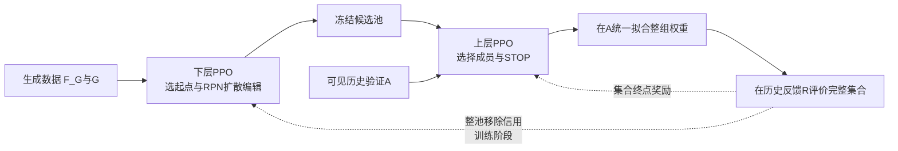

# 双层PPO候选生成与集合筛选重设计

日期为2026-11-10。本文为研究与实施方案，金融效果由后续配对实验验证。

## 摘要

建议将当前“上层选择起点、下层修改公式”调整为“下层生成候选池、上层选择因子集合”。下层内部同时学习起点选择和合法RPN编辑扩散，上层面对完整候选池，学习在不同市场背景和容量预算下选择具有跨期预测能力的子集。组合权重由确定性的正则化模型统一拟合，上层学习离散的集合结构。

组合评价以最终集合为单位。在独立历史反馈段评价整组预测表现、时间稳定性及成员独立有效性，通过连续终点效用训练上层。下层首先按搜索质量、相对冻结档案的新颖性及计算成本训练，再周期性接收“移除一个生成提案对整池可选价值的影响”。两层的奖励各有职责，数学联系由共同系统目标和反事实基线给出。

推荐先实施最小闭环。保留原生RPN、合法编辑核和PPO概率重放校验，增加下层起点头、候选池接口、上层集合编码器及统一组合评价器。数据边界、集合选择效果、整池信用和速度优化分别验收。少步蒸馏、动态生成需求和完整因子池扩散放入后续对照。



本次检索下载了32份公开论文全文，核对了会议页面、arXiv元数据及部分出版DOI。近期的AlphaPADI已涉及因子池感知的层次离散扩散，Alpha-R1已涉及强化学习驱动的二阶段因子筛选。因此，科研贡献需要落在明确的双PPO分工、跨期集合评价、跨层信用及预算效率的联合验证上。相关构件和论文来源列于第3节与附录。

## 1. 现有方案暴露的问题

### 1.1 已有证据能支持到哪里

| 核对项目 | 结果 | 对重设计的含义 |
|---|---|---|
| 固定随机上层的下层诊断 | 每32次尝试，随机合法编辑发现3.50个，结构预训练4.75个，金融PPO父下层5.83个 | 金融训练提高了搜索命中，后续价值需要另行验证 |
| 上述三组的后续达标数 | 分别为0.50、1.00、0.42个 | 单因子搜索分数与跨期质量存在脱节 |
| 最新C组与同一下层的随机上层 | 15秒严格成功均值1.17与1.00，固定32次时0.17与0.33 | 起点调度优势受种子和预算影响 |
| 修改前父下层加随机调度 | 15秒严格成功均值1.67，后续组合IC增量约+0.00328 | 最新共同奖励变体的整体优势尚待建立 |
| C组下层训练奖励 | 576个主候选中526个为零，14个为正，36个为负 | 门槛前置后的离散反馈损失了大量质量差异 |
| 原生RPN完整搜索 | 完成吞吐从7.97提高到8.55个候选/秒，约+7.3% | 表示优化有收益，仍需分解合法动作构造、网络与金融评价成本 |
| 概率重放及训练更新审计 | 各模型上下层各6次实际更新，最大旧概率误差约9.54×10⁻⁷ | 本轮证据允许把关注点转向目标、样本量和决策职责 |

下层诊断复用了历史模型，存在训练历史、初始化和检查点选择的差异。C组仅有三个配对种子和短训练。以上结果用于提出机制假设，其因果归属和收敛情况需要新的配对实验。[下层诊断](D:/Projects/Python/QuantLab-backtest/var/experiments/architecture_study_20261109/lower_only/comparison.json) · [最新结果](D:/Projects/Python/QuantLab-backtest/var/experiments/rpn_goal_alignment_20261110/comparison.csv) · [更新审计](D:/Projects/Python/QuantLab-backtest/var/experiments/rpn_goal_alignment_20261110/paired_initial_and_update_audit.json) · [速度对照](D:/Projects/Python/QuantLab-backtest/var/experiments/native_rpn_speed_20261110/speed_comparison.json)

### 1.2 根本问题更接近决策对象与评价对象的错位

现有上层处理的是“下一次从哪里编辑”。目标却是“最终得到怎样的因子集合”。起点对终点的影响还要经过扰动、下层编辑、数值求值、单因子门槛、去重和组合接纳。上层对最终集合的控制间接，承担了较长的信用链。

原方案下层按拟合期单因子质量学习，上层按新发现数及搜索期组合IC改善学习。后续共同奖励实验又把两层的目标替换为相同的完成反馈。前者需要跨层对齐，后者又把后续质量、去重及组合门槛同时压到了下层。零奖励过多是这一变体中已经观察到的现象。

工作组合采用逐个加入或单成员替换，保留当下搜索期改善的方案。这种局部过程受到当前成员、容量和到达顺序影响。两个因子可能需要同时出现才体现互补性，强相关因子也可能包含有用的条件信息。这是全池集合选择需要检验的理由。

以上机制还与训练规模、条件利用不足、样本噪声和时间漂移相互作用。单靠延长训练能否修复，取决于固定评价目标下验证曲线是否继续改善。

### 1.3 数据与计算也是独立的研究问题

当前参考面板包含500只股票，覆盖2021-06-18至2026-02-13，收益标签为20交易日期限。清单中的数据约定核验标记为false，2025年部分换手率缺失已被标记。新方法正式验收前，需要补齐股票池时点性、复权、停牌、退市和收益标签的审计。[数据清单](D:/Projects/Python/QuantLab-backtest/var/experiments/mechanism_study_20261109/data_missingness_reference/manifest.json)

已有微剖析中，合法替换检查、候选排序、文本构造和正向扰动占据明显调用开销。该剖析针对24个公式的编辑微基准，累计时间包含嵌套调用，解释范围限于这项基准。完整金融搜索需重新计时。[原生RPN剖析](D:/Projects/Python/QuantLab-backtest/var/experiments/native_rpn_speed_20261110/profile_rpn_native_v4.txt)

## 2. 对新分工的四个判断

### 2.1 起点选择并入下层是合理的

选择起点、选择扰动强度和完成编辑，共同决定一个公式的生成分布。这些动作共享公式表示和终点质量反馈。把起点选择作为下层轨迹的第一个动作，可以减少跨PPO传递一次公式生成信用的需要。

下层仍保留“起点头”和“去噪编辑头”两个功能模块，两者由同一个下层PPO训练。每条轨迹记录各动作概率，终点评分回传到起点及编辑步骤。

### 2.2 上层集合选择具有学习空间，必要性需要实证

从N个候选中选择至多K个成员，权重拟合后得到的后续表现通常具有非线性集合依赖。候选独立排名难以表达冗余、互补、容量约束及停止决策。集合PPO能够在许多历史任务上摊销这类求解经验。

强化学习的价值条件是任务反复出现、候选池随时期变化、评价昂贵或需要多步取舍。对于固定的单个候选池，强组合优化器可能更合适。上层应与Elastic Net、前向选择加交换、束搜索及小规模穷举比较。论文主张应以这些对照中的稳定增量为依据。[R6][R7][R8]

### 2.3 严格的单因子门槛会限制互补搜索

坚持下层输出IC、RankIC、ICIR均达标的因子，明确了研究对象是“有独立预测力的互补因子”。纯粹用于对冲其他因子噪声的变量可能被这一要求排除。主方案保留该约束，另设放宽门槛的探索对照，用于测量它损失了多少组合机会。

低相关性可以用于表示和探索引导。组合价值仍由联合预测及跨期稳定性决定，近零相关的噪声也会呈现很高的表面多样性。

### 2.4 两个PPO的数量本身不能证明层次价值

本文把层次定义为两个嵌套的决策对象。内层生成原子公式，外层选择公式集合。前向运行顺序为生成后选择，训练闭环通过集合结果向生成器传递信用。

分层的工程依据是两种动作空间、两套信息边界及不同的更新频率。以128个提案、每个起点后2步编辑、最终选择16个成员为例，联合过程包含约400个动作。下层可将每个3动作的生成问题单独训练，上层集中处理至多16次选择，语法技能和候选池也能分别复用。实际轨迹长度随失败和STOP变化记录。

经典options型HRL还需要上层发出生成目标并调用下层。该机制可以作为后续扩展，首轮采用“分层随机优化”的清晰定义，减少额外的需求动作、时长控制及验证反馈适应问题。两层必要性的可检验命题分别为生成策略增量、集合策略增量和闭环协同增量。

单PPO也能形式化联合过程。实验增加共享参数、统一价值函数的单PPO联合策略，匹配动作能力、候选预算、系统目标及参数规模，用来检验拆成两个学习器本身的作用。

## 3. 文献中的核心机制及迁移边界

以下“已有研究”描述来源论文，“迁移设计”描述本方案提出的应用方式。论文在原领域的速度或收益用于理解机制。

| 方向与来源 | 已有研究的核心 | 迁移设计 | 边界 |
|---|---|---|---|
| Options、FeUdal、HIRO [R1–R3] | 不同时间尺度的决策及下层变化导致的高层非平稳性 | 冻结一层采集另一层的新轨迹，记录模型与池版本 | HIRO使用的离策略修正需要独立迁移研究，首轮采用在策略采集 |
| 用户给出的RL数据选择 [R4] | 将预算约束的子集选择建成MDP，用代理模型下游表现提供反馈 | 上层动作选择候选，终点评价真实集合，轻量模型服务于训练 | 该文属于NeurIPS 2025工作坊，其代理奖励的金融有效性需实测 |
| Deep Sets、Set Transformer [R5–R6] | 集合置换性质及元素交互建模 | 无候选顺序位置编码的集合策略、选中集合上下文 | 均值池化可能压缩互补关系，应与显式相关性特征比较 |
| 图组合优化、注意力路径规划 [R7–R8] | 在重复问题上学习构造解的策略 | 选择下一候选及STOP，终点统一拟合整组权重 | 普通求解器仍是必要的强基线 |
| 弱次模选择、DPP [R9–R10] | 子集预测的条件性与集合多样性建模 | 分析贪心失败，DPP作为多样性选择对照 | 本任务的后续IC目标需重新检查单调性与次模性 |
| Data Shapley、COMA [R11–R12] | 元素价值依赖上下文，反事实基线可改善信用分配 | 用整池移除后的可选价值差给生成提案分配反馈 | 本方案采用移除基线，Shapley值需要对不同子集求平均 |
| D3PM、SEDD、MDLM [R13–R15] | 离散噪声过程、逆过程及其训练目标 | 有明确合法状态空间、时间步和逆动作支持的RPN编辑扩散 | 词元独立掩码与联合公式合法性需分别保证 |
| DDPO、DPPO [R16–R17] | 把去噪轨迹作为策略梯度的决策过程 | 记录根选择及编辑的真实概率，PPO优化下游目标 | 连续高斯去噪的似然公式与离散编辑的概率分别推导 |
| MaskGIT、渐进蒸馏、Consistency、Fast-dLLM [R18–R21] | 迭代修正、少步生成、缓存及并行解码 | 批量公式编辑、候选缓存，后续研究离散轨迹蒸馏 | 当前仅2步编辑，减少调用次数的收益需与动作构造开销比较 |
| DSR、质量多样性、GFlowNet [R22–R24] | 约束符号生成、高质量解覆盖和多模态探索 | 有质量约束的多样候选档案，防止集中于少数模板 | DQD的梯度要求与符号黑箱有差异，风险偏好优化也可能增加历史过拟合 |
| Group DRO、CPO [R25–R26] | 最差组泛化及约束目标的建模 | 时段稳定性惩罚、准入约束与独立验收 | 最差窗口分数受短样本噪声影响，应与均值及方差惩罚比较 |
| AlphaGen、AlphaForge [R27–R28] | 组合导向生成，以及生成和动态组合的分阶段处理 | 作为金融领域最接近的目标和流水线基线 | 双PPO分工及严格跨期边界需要单独验证 |
| AlphaPADI [R29] | 因子池整体生成、多尺度离散扩散及池级偏好反馈 | 将整池生成作为替代研究方向及近邻对照 | “池感知＋层次扩散”已有相关设计，创新主张应进一步具体化 |
| AlphaPareto、Alpha-R1 [R30–R31] | 多目标因子池建模，强化学习驱动的二阶段因子筛选 | 比较多目标池评价与候选再筛选机制 | 依赖LLM的成本、数据及市场状态信息需公平处理 |
| 多重检验、数据窥探、协方差收缩 [R32–R34] | 大规模筛选偏差及高维组合估计风险 | 时序保留集、日期块统计、Ridge与收缩基线 | 模型种子和大量重叠任务分别统计其依赖关系 |

### 3.1 与近期相关工作的区分

AlphaPADI全文把完整因子池作为生成对象，使用叶、子树及整公式层级的掩码，池级预测和内部多样性评价驱动精英缓存、重构及偏好学习。其“层次”主要描述结构层级。该文当前按公开预印本引用。[R29]

本方案的生成对象为单个公式，外层决策对象为候选子集。拟研究的差异是明确的生成PPO与选择PPO、独立历史区间中的集合评价，以及候选提案到整池可选价值的信用关系。AlphaPADI的层次掩码通过AST节点定义，原生RPN区间实现可形成一个独立的工程比较。是否形成足够的创新贡献，需要结合AlphaPADI、AlphaForge及Alpha-R1的协议和实验进一步判断。

AlphaPareto的arXiv元数据注明NeurIPS 2026主会接收，本次会务页核验遇到访问限制，引用时保留这一核验层级。用户提供的UAV论文已通过Crossref核对题名、卷号及DOI，全文获取受限，其QMIX/DQN细节的依据目前来自用户提供简介。[R30][R35]

## 4. 四种可选框架

| 框架 | 两层工作方式及合理性 | 潜在新意 | 训练难度 | 主要计算成本 | 判断 |
|---|---|---|---|---|---|
| A 分阶段生成与集合选择 | 下层生成冻结池，上层选择子集，职责清楚 | 单靠两阶段结构的新意有限，AlphaForge已有相关思路 | 较低，容易定位每层增量 | 生成与集合采样，信号可复用 | 最小可行版本 |
| B A加整池反事实信用 | 移除提案后的整池价值反馈给下层，目标有可推导联系 | 研究价值在跨期协议、整池信用条件及双PPO协同的系统验证 | 中等，受选择器成熟度及信用方差影响 | 每个微批追加若干选择及小集合评价 | 推荐完整方案 |
| C 上层连续输出所有权重 | 同时做稀疏门控与动态配置，适合配置研究 | 组合配置已有较多工作，新意取决于新的约束与状态建模 | 较高，混合动作、比例不识别和归一化增加难度 | 更长配置训练及组合回测 | 研究对照 |
| D 完整因子池扩散 | 联合重建多条公式，直接建模生成期互补性 | 与AlphaPADI高度接近，需要另设具体贡献 | 高，联合概率及合法性检查更复杂 | 大状态生成、重构训练和池级评价 | 后续方向 |

推荐路线为A验证职责，再用B验证闭环。上层的连续权重先交由同一确定性拟合器处理，以便把研究问题集中在公式生成与集合选择。

## 5. 数据时间边界

### 5.1 每个历史任务的四个区间

| 记号 | 用途 | 可进入的模块 |
|---|---|---|
| F_G | 确定单因子使用方向，提供下层拟合背景 | 下层状态及评分 |
| G | 下层搜索、连续质量奖励及候选初筛 | 下层状态、奖励、候选档案 |
| A | 独立于生成筛选段的历史观察，检验成员稳定性并拟合组合权重 | 上层状态、准入及权重拟合器 |
| R | 时间更晚的历史反馈段 | 训练时上层终点效用及跨层信用 |

初筛可从F_G约120日、G约40日、A约80日、R约60日开始，具体日期先按数据使用清单确定。各边界按标签实际结束日剔除跨界样本，历史回看区间独立提供。20日标签下，60日R段包含的有效独立信息有限，首轮用于机制筛查。正式证据需要更长窗口及更多独立时段。

一个候选在G产生，在A获得可见的验证统计，在R接受后续评价。上层策略和价值网络的输入来自截至A结束已成熟的信息。R标签在该历史任务训练结束后用于计算目标。方向由F_G确定，组合权重由A拟合，评分时沿用已拟合结果。

### 5.2 全局训练、开发与最终保留集

所有历史任务再分为训练任务、开发任务D和最终保留任务H。训练任务的R标签须在开发或测试决策时点前成熟。最终保留任务提供H_R反馈，仅在协议、超参数和选择方法冻结后评价。

过去已用于生成509条公式、筛出93条公式的开发区间，以及被多轮分析过的时期，登记为已使用数据。新保留期根据数据使用审计确定。若现有时期均已参与方法选择，独立验收需要扩展时间或市场数据。

候选库和起点库均保存发现时间、筛选标签最晚成熟时间及模型版本。按历史时点回放时，只加载当时能够取得的库成员。

### 5.3 减少验证反复适应

同一个冻结候选池可以用于上层多条在策略选择轨迹训练，但它们共享金融信息。报告中分别给出独立时间块、任务、候选池、模型种子和策略采样数。

原方案扩展中的“上层发现缺口后再要求下层回到G挖掘”会使A间接影响候选生成。它需要计入适应性选择过程，并以更晚R评价。首轮采用固定候选池，让生成与验证职责更容易审计。

## 6. 下层PPO

### 6.1 状态和动作

下层状态包括当前原生RPN程序、剩余去噪步数、任务背景、冻结起点档案A₀、起点及编辑历史统计、预算，以及当前生成器版本。

一条生成轨迹分为两个阶段。

1. 起点动作从合法起点短名单与NEW中选择。NEW调用有明确概率及失败预算的文法先验。
2. 按给定正向噪声核扰动，再依剩余时间步执行反向编辑。编辑动作为位置及合法替换，也可按操作类型、位置和参数作条件分解。

两个阶段属于同一个下层策略。正向噪声核固定时，轨迹概率为

\[
p_\theta(\tau\mid h,A_0)
=\pi^{\rm root}_\theta(j\mid h,A_0)
q(x_T\mid f_j)
\prod_{t=T}^{1}\pi^{\rm edit}_\theta(a_t\mid x_t,t,h,A_0).
\]

PPO使用实际记录的根动作和编辑动作概率。对类型、位置及替换的条件分解，联合对数概率等于各条件对数概率之和。合法动作集合与采集时一致，缓存的支持集合、随机提案和回退事件一并保存。[R37]

### 6.2 下层的扩散模型怎样成立

状态空间为满足文法、尺寸、深度、回看及量纲约束的有限RPN程序集合。正向过程以合法局部修改增加扰动，反向模型根据噪声步数学习还原或改进公式。结构预训练用已知逆动作的负对数似然，随后以PPO优化金融终点。

正向扰动与反向动作都通过原生词元区间操作实现，类型及回看摘要由栈扫描获得。每个监督逆动作都必须处于反向模型的支持集合，执行后能够还原前态。

这给出条件编辑扩散的定义。进一步宣称特定D3PM变分界，需要补充对应的前向转移、后验和逆过程推导。连续扩散的DDIM或ODE跳步方法需要适配离散合法状态空间。[R13–R17]

### 6.3 合格标准与连续训练反馈分别定义

候选入池要求结构合法、数值可靠、覆盖率达标，以及G上的有向IC、RankIC、ICIR达到预登记门槛。方向

\[
d_f=\operatorname{sign}(IC_{F_G}(f))
\]

在F_G确定，零值按固定规则处理。G上的指标使用同一方向。

首轮可沿用IC≥0.02、RankIC≥0.01、覆盖率≥0.8。ICIR采用日截面IC均值除以标准差，首轮门槛可设0.10并登记为待验证参数。该数值需要与原门槛对照，通过开发集决定后冻结。重叠20日收益标签的显著性另外用日期块统计。

训练终点使用连续的门槛距离。令三个有向质量指标为m_j，对应门槛为τ_j，尺度s_j由训练任务预先确定。

\[
u_G(f)=\frac13\sum_{j=1}^{3}\tanh\!\left(\frac{m_j(f)-\tau_j}{s_j}\right)
-\lambda_{\rm cov}\frac{[\tau_{\rm cov}-\operatorname{cov}(f)]_+}{s_{\rm cov}}.
\]

可执行但未达门槛的公式仍得到有区分度的负值或低分。求值失败使用固定负分并记录原因。新增候选的入池判断保持为可审计布尔条件。

### 6.4 多样性与成本

定义n_G(f;A₀)为相对批次开始时冻结合格档案的新颖性，例如一减最大平均绝对截面相关性。高相关性在此形成柔性探索信号，精确信号等价及公式重复另行处理。

本批提案之间的互补性由第9节的整池价值反馈处理。档案A₀在整批收集和信用计算完成后统一更新。

计算成本c(f)覆盖起点选择、扰动、反向编辑及G评价，除以固定的训练校准尺度。完整训练和部署同时记录墙钟成本与首次执行公式数。根先验耗尽、非法结果、低质量结果和重复结果均计入尝试预算。

## 7. 上层PPO究竟学习什么

### 7.1 学习对象是集合构造策略

冻结本次候选池C后，上层从空集合S₀开始，依次选择一个候选或STOP。它学习的是给定市场背景、候选关系和容量限制时，怎样构造具有后续价值的集合。

中间选择只改变集合标记。终止后统一拟合整个集合的组合权重并评价。这一过程允许早期选择暂时缺少单独贡献的成员，由后续选择完成互补结构。

联合评价通过同一全池上的多个完整子集采样实现，搜索空间仍为组合量级，PPO提供近似求解策略。首轮主结果采用预登记的单次策略采样，并用重复采样统计波动。贪心解码及多次采样择优列为推理预算对照。

### 7.2 状态和网络

每个候选的输入包括RPN语法表示、A上的有向IC/RankIC/ICIR、分块稳定性、覆盖率、缺失率、复杂度、来源家族和计算成本。集合输入包括全池关系、已选成员、剩余容量、A结束前可见的市场背景。

相关性特征保留符号，并提供跨窗口变化。选中成员上下文可包含其均值表示、候选与已选集合的相关性摘要和家族覆盖。

首轮采用两层、宽度64的集合注意力编码器，候选序列不加入顺序位置编码。Actor对未选成员和STOP输出概率，Critic估计当前部分集合的最终效用。两者使用独立参数。N约128时先采用标准注意力，候选规模扩大后再比较诱导点Set Transformer。[R5–R8]

### 7.3 动作空间及停止

\[
\mathcal A(S)=\{i\in C_A:i\notin S\}\cup\{\mathrm{STOP}\},
\qquad |S|\le K_{\max}.
\]

C_A为通过A段可靠性及独立质量筛选的成员。A段准入门槛单独登记，并在所有上层对照中一致。到达容量上限后终止，候选不足时允许空集合或较小集合。

首轮建议N上限128，K上限16。N表示候选池容量，实际合格数量取决于总提案预算和两段准入率。候选池可由多个已完成微批次积累，全部生成成本计入。A合格成员不足时允许较小集合。固定K及允许STOP分别比较，以判断策略是否通过选取较少成员获得表面收益。

### 7.4 强化学习的可证伪理由

普通排名依据每个候选自身分数。集合PPO能根据已选集合改变后续动作，学习条件互补、避免重复选择同类信号，并分配有限名额。这一能力是否有用，需在冻结候选池上与强组合算法直接比较。

把上层换成候选独立打分器、上下文赌博机、前向选择和束搜索，可以分别检验集合交互、多步信用及训练摊销的贡献。另加“监督集合价值模型加束搜索”，使用相同训练任务的历史R反馈学习效用，再以A特征选择。这样可以比较PPO优化与集合价值建模各自的作用。若这些对照在相同总预算内稳定达到更好结果，则双PPO架构中的上层研究假设需要修订。

## 8. 从整体候选池建立组合评价

### 8.1 先计算池关系，再评价最终子集

全池在A形成统一信号矩阵X_A。每个最终子集S对应列集合，使用相同的正则化拟合器

\[
w_A^*(S)=\arg\min_w\left\{\frac{1}{n_A}\|y_A-X_{A,S}w\|_W^2+\lambda\|w\|_2^2\right\}.
\]

λ取正数，由训练及开发协议确定，R评分沿用w_A^*(S)。对S中的每个因子，方向d_f同样沿用F_G结果。权重可正可负，Ridge用于缓解相关性和估计方差。

全池协方差、标签相关矩及候选关系可被所有集合选择方法复用。评价器的输入为完整子集，统一输出成员、权重、IC序列、稳定性和独立质量代价。

### 8.2 连续的上层终点效用

把R划成预登记时间块R₁至R_J。令I_j(S)为使用A拟合权重后，在R_j上的有向组合IC。定义

\[
\mathcal U_R(S)=
\frac{\operatorname{mean}_j I_j(S)}{s_I}
-\lambda_s\frac{\operatorname{sd}_j I_j(S)}{s_I}
-\lambda_q D_R(S)
-\lambda_K\frac{|S|}{K_{\max}}.
\]

D_R(S)为入选成员在R的IC、RankIC和ICIR低于门槛的连续欠缺度均值。可沿用第6节的标准化门槛距离，取softplus形式。这样，组合表现改善与成员预测能力不足都会产生连续反馈。空集合效用定义为零。

λ_s、λ_q、λ_K及尺度在训练任务上校准，开发阶段仅进行预登记的小范围比较。标准差项表达时间稳定性，统计置信区间另行采用日期块bootstrap估计。

主效用采用组合有向IC，成员RankIC与ICIR进入准入和欠缺度。最终组合RankIC、交易收益、换手和成本单独报告。若把组合RankIC或交易成本并入每个训练终点，它们的额外计算应计入公平预算。

### 8.3 上层奖励

终止前的基础奖励为零，终止动作得到连续效用U_R(S)。初期K≤16，终点回报可以直接训练。需要进一步降低方差时，加入基于A信息的势函数Φ。

\[
r_t^U=r_t^{\rm base}+\gamma\Phi(s_{t+1})-\Phi(s_t),
\quad\gamma=1,\quad\Phi(s_T)=0.
\]

因此

\[
\sum_{t=0}^{T-1}r_t^U=\mathcal U_R(S_T)-\Phi(s_0).
\]

只要起始势能与动作无关，终止势能为零，整回合优化目标保留。Φ可以由冻结的A段集合评分代理提供，其版本在采集和更新期间固定。跨层V值使用原始U_R，势函数的作用范围限定在上层回报整形。PPO使用GAE计算优势，首轮λ_GAE=0.95。PPO更新和有限样本估计仍可能受优化偏差影响。[R36]

### 8.4 联合价值具有递增贡献的反例

令y与n独立且方差为一，候选x₁=y+4n，x₂=0.04y+n。它们与y的相关性分别约0.243和0.040，具有独立预测力。

以总体线性预测R²作为演示效用，单独使用x₁和x₂分别得到0.05882和0.00160。联合使用两者可恢复y，R²为1。x₂从空集合起的贡献约0.00160，已有x₁时贡献约0.94118。存在明显的递增贡献。

该反例说明，子集预测的贪心近似界需要相应的数学条件。它提供互补性的代数证据，真实市场和跨期正则化效用的效果由实验判断。[R9] · [合成检查结果](D:/Projects/Python/QuantLab-backtest/var/experiments/ppo_redesign_research_20261110/design_sanity_results.json)

### 8.5 怎样识别具有组合价值的单因子

最终输出保存完整选中集合和权重，并为成员报告独立预测质量、在不同任务中的入选频率，以及整池移除信用的分布。

一个因子的价值依赖候选池、市场时段、拟合器和约束。跨任务稳定入选且具有正信用，可作为组合价值的证据。验证结果按具体背景保存，便于复核。

精确重复和相同信号需要分组处理。相同特征复制多份会降低等效Ridge惩罚，可能制造虚假的组合改善。可复用现有PoolStats对精确信号等价组的处理，近相关候选保留其差异进行联合评价。

## 9. 两层目标的数学联系

### 9.1 固定批次生成与外层选择

令C₀为本任务开始时已确定的候选背景，A₀为冻结生成档案。下层独立生成B个带来源索引的提案f₁至f_B。通过G和A准入的提案映射为候选池C，重复提案及失败提案保留原始索引和中性占位，预算按全部提案统计。

上层在C中生成子集S。对固定上层参数φ，定义整池可选价值

\[
V_\phi(C)=\mathbb E_{S\sim\pi_\phi^U(\cdot\mid C,A)}[\mathcal U_R(S)].
\]

本方案使用期望价值，Monte Carlo均值是其估计。取多次选择中的最好值会改变优化对象，需要作为独立的推理搜索协议记录。

### 9.2 系统目标

定义

\[
\mathcal J(\theta,\phi)=
\mathbb E_{C\sim P_\theta}\!\left[
\eta V_\phi(C)
+\frac{\alpha}{B}\sum_b u_G(f_b)
+\frac{\beta}{B}\sum_b n_G(f_b;A_0)
-\frac{\kappa}{B}\sum_b c(f_b)
\right].
\]

上层更新时，候选池与下层固定，后三项与上层动作无关，因此上层只需优化U_R。下层更新时，上层固定，既优化候选供给质量，也优化最终集合的可选价值。

此处的期望以当前任务、C₀和A₀为条件。推导针对固定微批背景的目标，跨批次档案演化的长期最优性需要另行研究。交替PPO的全局收敛也需要额外条件。

该式表达效用、质量、多样性与成本之间的显式权衡。有限计算预算下的实际收益还需以完整部署墙钟实验验证。

### 9.3 整池移除信用

对第b个提案定义

\[
D_b=V_\phi(C)-V_\phi(C^{-b}),
\]

C⁻ᵇ表示移除该生成提案后、按同一准入及去重规则得到的候选池。每次反事实都在该池中重新执行同一版本的集合策略，并在A重新拟合所选完整子集的权重。若另一个提案提供相同公式，移除操作按来源计数重建池。

可被其他候选替代的有效因子，D_b可能接近零。因子库保留其独立质量和替代家族信息，最终集合由上层选择，D_b的符号作为信用证据记录。

固定C₀、A₀和φ，若本批提案条件独立，则C⁻ᵇ与当前提案f_b的采样独立，因此

\[
\mathbb E[\nabla_\theta\log p_\theta(\tau_b)V_\phi(C^{-b})]=0.
\]

由似然比梯度得到

\[
\nabla_\theta\mathbb E[V_\phi(C)]
=\mathbb E\!\left[\sum_b\nabla_\theta\log p_\theta(\tau_b)D_b\right].
\]

相应的下层终点奖励为

\[
r_b^L=
\eta\widehat D_b
+\frac{\alpha}{B}u_G(f_b)
+\frac{\beta}{B}n_G(f_b;A_0)
-\frac{\kappa}{B}c(f_b).
\]

上层采用集合效用，下层采用该提案的整池信用及供给质量、成本反馈。两层具有明确的不同职责，并对应系统目标的两个参数块。

### 9.4 该推导的适用条件

1. 整批收集时固定上层参数、生成档案、背景候选及评分协议。起点短名单、使用次数和归一化统计等全部采样可见状态也在批内冻结。
2. 提案在同一固定背景下独立采样，批内允许重复生成并保存来源，档案统一延后提交。现有逐候选提交的采集逻辑需要调整为独立微批次采集。
3. 候选按固定提案数收集，失败和重复均保留来源，随机停止或只保留成功轨迹需要另外处理选择偏差。
4. 反事实选择使用同一版本上层，并重新构造候选掩码与集合状态。
5. 仅对被选中成员计算移除值，会改变信用估计的采样机制。首轮小B计算全部提案。
6. 对照选择与主选择可使用独立于候选生成的共同随机数，降低差分方差。每个值使用固定次数采样的均值。
7. 策略梯度恒等式适用于固定策略下的期望。PPO裁剪、有限采样和Critic误差带来的偏差单独记录。

当提案依赖批内先前候选时，C⁻ᵇ可能间接依赖f_b。此时需使用依赖当前动作之前历史的基线，或重新推导顺序生成信用。冻结微批次是首轮的简化选择。[R11–R12]

### 9.5 可行的信用计算规模

下层独立预训练先令η=0，学习质量、多样性和成本。上层在冻结候选池上训练稳定后，再启用小规模的整池信用。

D_b评价的是候选对当前选择器的价值。选择器能力不足时，有用的候选也可能得到较小信用。阶段S3的强基线对照用于检查这一问题，阶段S4同时保留下层自身的连续质量反馈。

建议联合阶段使用16个新提案，配合至多112个冻结背景成员。每个池值采用2次上层采样，最多需要34次完整集合评价。所有候选信号及A/R统计矩复用，反事实阶段主要计算集合策略和小维度线性系统。

若信用成本占比过大，可在新实验中采用预先随机选定的提案位置。抽样概率必须独立于生成结果，采用相应的加权估计，并比较方差及吞吐。

## 10. 训练流程

### 10.1 阶段安排

| 阶段 | 训练对象 | 固定内容 | 需要回答的问题 |
|---|---|---|---|
| S0 | 数据和评价器校验 | 同一候选流 | 时间边界、去重、权重、集合评分是否可信 |
| S1 | 下层根选择和结构去噪预训练 | 文法及噪声核 | 合法动作支持、逆动作恢复及根概率是否一致 |
| S2 | 下层PPO | 固定档案微批次，上层暂不提供信用 | 连续质量和多样性是否提高合格非重复产出 |
| S3 | 上层集合PPO | 冻结下层与候选池 | 集合策略能否超过强筛选及组合优化基线 |
| S4 | 下层整池信用PPO | 冻结上层 | 改变候选供给是否提高整池可选价值 |
| S5 | 交替训练 | 每次更新对应另一层的明确版本 | 闭环是否带来额外收益 |
| S6 | 最终保留集评价 | 全部协议与模型冻结 | 后续质量、组合价值和预算效率能否保持 |

### 10.2 交替训练伪代码

```text
初始化下层根选择头、合法RPN扩散编辑器和上层集合策略
完成结构预训练与独立下层训练

重复执行
    选择一个训练历史任务，核验F_G、G、A、R的标签成熟顺序
    固定档案A0、背景候选C0、下层版本theta_old和上层版本phi_old

    用theta_old独立生成固定B个提案
    记录根动作、扩散动作、真实旧概率、失败、耗时和提案来源
    在G做初筛，在A计算上层可见特征，构造带来源映射的候选池

    用phi_old估计完整池和逐提案移除池的期望集合效用
    构造每个提案的下层终点奖励
    用这些在策略轨迹更新下层PPO
    统一提交本批候选到档案

    固定更新后的下层，重新生成用于上层训练的候选池
    用当前上层收集新的集合选择轨迹
    终止时在A统一拟合权重，在R计算连续集合效用
    计算上层回报和GAE，更新上层PPO

    保存两层版本、候选池、数据身份、优化器、随机状态和实际成本
    按预登记开发协议评价并选择检查点
```

上层可以反复使用冻结候选池，但每次PPO更新须重新采集当前上层的动作轨迹。模型更新后的嵌入、合法动作缓存和状态特征按其依赖版本失效。

### 10.3 建议初筛规模

首轮使用500只股票、N≤128、K≤16、原生RPN最大长度15或20、2至4步编辑、3个配对种子。下层每批32至128条主提案，金融PPO可先执行64个批次，上层在多个冻结池上执行256个批次，批次含多个集合回合。具体停止点以开发曲线和预登记计算上限共同控制。

2步与4步、起点头学习与随机起点、额外续采样1与3分别比较。首轮下层按终点Monte Carlo回报训练，额外续采样的训练成本统一记账。

该规模用于发现无效目标、输入失效和计算瓶颈。正式结论需要扩大任务覆盖、独立时间段及种子，并根据验证收益随训练量变化决定是否追加。

### 10.4 两层PPO的更新规格

对任一层参数ω，使用采集策略ω_old记录的动作概率

\[
\rho_t(\omega)=\frac{\pi_\omega(a_t\mid s_t)}{\pi_{\omega_{\rm old}}(a_t\mid s_t)},
\qquad
L_{\rm clip}(\omega)=\mathbb E\!\left[
\min\big(\rho_t\widehat A_t,
\operatorname{clip}(\rho_t,1-\epsilon,1+\epsilon)\widehat A_t\big)
\right].
\]

下层以第9节的提案终点评分作为各根动作及编辑动作的不折扣Monte Carlo回报，用r_b^L−V_L(s_t)估计优势。Critic拟合相应回报。上层用集合终点效用或势函数整形奖励计算GAE

\[
\delta_t=r_t^U+V_U(s_{t+1})-V_U(s_t),
\qquad \widehat A_t=\delta_t+\lambda_{\rm GAE}\widehat A_{t+1},
\quad V_U(s_T)=0.
\]

两层分别设置优化器和Critic。初筛可沿用学习率3×10⁻⁴、每批4轮小批次更新、梯度范数上限1、下层clip=0.2、上层clip=0.1及上层目标KL约0.01，并按开发结果冻结。每次更新前重放旧动作，沿用约2×10⁻⁵的概率误差检查。

策略项先按每条提案或集合回合对动作求和，再按提案或回合数归一化。根选择失败、可变编辑步数以及STOP导致的不同长度均记录下来，保持损失与回合目标的对应关系。

若一个编辑分为位置和替换，其联合熵为H(位置)+Σ_p π(p)H(替换|p)。首轮按明确的分布计算正则项，后续近似熵或动作采样优化单独记录。公式合法性掩码及Critic输入在旧概率检查与训练重放时一致。

## 11. 搜索与评价加速

### 11.1 第一优先级是具有等价性检查的工程优化

| 环节 | 具体修改 | 核验内容 |
|---|---|---|
| 原生RPN编辑 | 继续用词元区间替换、操作数栈和局部语义摘要 | 编辑后合法性与已有等价轨迹 |
| 动作构造 | 用词元编号及静态类别排序，合并重复候选，缓存合法位置与操作支持 | 动作支持、排序映射和对数概率重放 |
| 网络计算 | 多公式批量编码，短序列按长度分桶，共用本次前向中的重复序列 | 与逐条计算的概率、价值一致性 |
| 子表达式评价 | 以结构、面板、窗口、缺失策略和算子版本为键复用 | 命中缓存与重算的逐元素一致性 |
| 单因子初筛 | 按安全顺序先处理结构、重复和低成本失败，再计算昂贵指标 | 最终合格集合及全部预算记录 |
| 组合评分 | 缓存全池拟合充分统计量与逐日矩，复用小子集线性系统 | 与直接组合信号求值一致 |

合法位置与合法替换之间存在条件依赖。随机拒绝、回退或动态裁掉替换会影响真实动作分布。优化后依然需要保存支持集合或足够的重建信息。

### 11.2 组合评分的缓存推导

在固定评分网格上，令第d日候选信号均值为μ_d，协方差为H_d，与标准化目标的交叉矩为c_d。对权重w有

\[
\operatorname{Var}(p_d)=w^\top H_dw,
\qquad \operatorname{Cov}(p_d,y_d)=c_d^\top w.
\]

目标方差为一时

\[
IC_d(S)=\frac{c_{d,S}^\top w_A^*(S)}{
\sqrt{w_A^*(S)^\top H_{d,SS}w_A^*(S)}}.
\]

A的Gram矩阵和标签矩也只需构建一次。N个候选的大矩阵成本可以在同池的多次选择、所有反事实池和优化基线之间摊销。缺失值按统一掩码处理，近常量组合采用直接信号复核。

组合RankIC需要对最终预测重新排名，交易换手需要实际持仓映射。它们的精确评价另行执行并记录成本。

合成完整面板中，逐日矩评分与直接计算的最大日IC误差为7.63×10⁻¹⁷。真实缺失面板、退化组合及权重迁移的回归测试在实现阶段补齐。[数学检查](D:/Projects/Python/QuantLab-backtest/var/experiments/ppo_redesign_research_20261110/design_sanity_results.json)

### 11.3 有近似误差的加速另设实验

1. 用固定小日期/股票网格或代理模型预筛，定期完整评价随机抽取的淘汰项，估计漏掉合格因子的比例。
2. 用低维信号投影检索近邻，再对边界候选做完整相关性核验，统计误合并和误过滤。
3. 对4步或更多步教师做离散轨迹蒸馏，测试2步学生及其合格、非重复产出。扩散时间步、逆动作支持及模型概率需要重新验证。
4. 多位置并行编辑要求区间相容及祖先语义联合合法，单位置合法性测试分别通过后，还需检查联合修改。

当前原型只有2步编辑，动作构造和评价仍消耗时间。首先测量各阶段成本占比，再决定蒸馏、网络压缩和并行编辑的投入。[R18–R21]

若被优化环节占完整耗时比例p，该环节加速s倍，理论整体加速为1/((1−p)+p/s)。例如p=0.15、s=2时，整体约为1.08倍。这里的p是假设场景，真实取值由完整搜索计时确定。

### 11.4 CPU与GPU安排

当前本机核对为Core Ultra 5 225H、14个逻辑处理器、约31.49 GiB内存，现有alphagen环境安装CPU版PyTorch。CPU侧适合并行公式求值、文法操作和缓存准备，GPU侧的价值主要来自批量神经前向与PPO更新。

建议先按工作负载比较4、8、12个单线程评价进程，神经更新集中在一个进程，避免进程与BLAS线程嵌套超额竞争。公司4060上的批量和显存占用按实机核验，CUDA环境单独登记。

float32信号缓存约占4×日期数×股票数×候选数的字节。例如240日、500股、128因子约61.44 MB。累计矩使用float64。按任务和模型版本限制内存缓存，避免为所有历史池同时保留信号。

## 12. 可验证的实验设计

### 12.1 分离各模块的贡献

| 实验 | 固定内容 | 比较内容 | 主要回答 |
|---|---|---|---|
| E0 评价器 | 固定公式及集合 | 直接评分、矩缓存、不同顺序、等价公式 | 评价是否可信、顺序是否只影响策略 |
| E1 下层独立有效性 | 随机或同一固定选择器、相同编辑预算 | 随机合法编辑、仅结构预训练、旧奖励、新连续奖励 | PPO是否改善候选供给 |
| E2 起点并入下层 | 同一编辑器与质量目标 | 随机起点、原上层调度、下层根选择头 | 新分工是否减少信用与计算损失 |
| E3 上层独立有效性 | 完全相同的冻结候选池与拟合器 | 随机、独立排名、相关性过滤、DPP、Elastic Net、前向加交换、束搜索、监督集合价值模型加搜索、集合PPO | 上层学到的集合策略是否有增量 |
| E4 跨层连接 | 相同初始化、主提案及金融评价预算 | 两层独立、整池共同终点、整池移除信用、代理信用 | 明确信用是否优于简单共享奖励 |
| E5 目标与输入 | 同池及预算 | 去掉时间稳定性、成员质量代价、集合关系或STOP | 哪个机制影响预测、组合与选择行为 |
| E6 扩散与速度 | 相同初始化与求值协议 | 1/2/4步、缓存/批量/代理/蒸馏逐项加入 | 单次成本与有效产出的真实权衡 |
| E7 完整系统 | 相同总预算和最终评价器 | 原双层、单PPO联合策略、A、B及完整池扩散近邻基线 | 重设计是否整体有效，两学习器拆分是否有增量 |

E3需要同时比较普通独立打分器和上下文赌博机，用于检验多步信用本身。小规模N≤12、K≤4时穷举最优集合，测量策略和启发式的最优差距。

可部署的排名、Elastic Net、前向、束搜索和穷举方法，只使用A及其内部有成熟间隔的时序交叉验证选择成员，最后在完整A拟合权重。监督模型和PPO均可使用同一组历史训练任务的R反馈训练。各方法的开发、训练和搜索成本分别登记。使用测试任务R标签穷举的结果标为事后oracle，用于衡量上限与机会缺口。

### 12.2 指标分为五组

1. 生成质量包括结构合法率、数值可靠率、G达标数、A达标数、精确重复和信号近重复率。
2. 单因子跨期质量包括R/H上的IC、RankIC、ICIR、覆盖、正窗口比例及方向反转率。
3. 集合质量包括整体预测IC/RankIC、分块稳定性、相对同池强基线的差值、成员独立质量及有效成员规模。
4. 交易表现包括统一执行规则下的成本前后收益、Sharpe、回撤、换手及风险暴露。20日标签对应的实际持有与滚动建仓规则需明确登记。
5. 计算效率包括编辑、求值、缓存准备、集合编码、拟合、反事实信用、PPO更新和部署各项耗时，以及完整预算内的合格非重复因子数与最终集合效用。

核心报告同时给出固定首次执行公式数和固定墙钟预算。原公式缓存重复、失败调用和训练前预计算的成本保留。上层离线训练成本及在重复任务中的摊销收益单列。

冷启动总成本与缓存预热后的稳定吞吐分别评价。各组使用相同的文法、起点库、主提案随机条件、评分网格和容量约束，新增根头采用配对初始化，其余可兼容参数逐项核验。

### 12.3 防止把重复样本当作独立证据

初筛3个配对种子，确认方向后扩展到至少5个，并报告种子间差异。市场统计按日期块和任务分组，块长至少覆盖20日标签跨度，并比较更长块的敏感性。候选池、窗口和任务重叠程度随结果给出。

多方法、多门槛及多模型选择均登记尝试次数。保留H用于最终验收，报告相对强基线的置信区间及数据窥探修正敏感性。[R32–R33]

### 12.4 何时追加训练，何时调整设计

验证曲线随批次和实际累计成本共同绘制。开发集主效用持续改善、种子差异可控且候选质量仍提高时，追加训练预算。训练奖励上升而独立R表现持续下降时，先检查评价、数据角色和过拟合。

固定候选池上的上层落后强启发式时，优先检查集合状态与训练目标。随机下层与金融PPO接近时，检查下层质量、起点头及探索覆盖。信用均值接近零或反事实成本很高时，检查池饱和、选择器能力及提案分布。

双层设计通过验收需要同时看到下层供给增量、上层选择增量和完整闭环的预算内收益。研究结果允许某一假设被否定，并据此收缩主张。

## 13. 最小实施方案与记录

### 13.1 主要代码职责

| 现有模块 | 需要承担的新职责 |
|---|---|
| models.py | 下层根动作与编辑动作，上层候选集合及选中集合编码 |
| rpn.py | 原生编辑、合法支持缓存及可逆噪声核 |
| evaluation.py | 固定网格指标、完整集合拟合、A/R矩缓存及退化处理 |
| search.py | 固定微批次生成、候选来源映射、统一入池和集合选择环境 |
| ppo.py | 两种轨迹的概率重放、目标与优化诊断 |
| training.py | 数据角色、冻结顺序、整池信用、开发选点与恢复 |

候选池和集合评价应拥有明确接口。首个版本采用独立研究入口及新实验目录，便于与旧模型的目标和结果分别追溯。

### 13.2 每个候选与集合应保存的内容

候选记录包含公式、规范ID、方向、来源根、扩散轨迹、生成时间、模型版本、G/A各窗口指标、失败原因和计算成本。完整轨迹保留旧概率及合法动作身份。

集合记录包含候选池清单、选择顺序、最终成员、A拟合权重、拟合器和正则化版本、R或H指标及成员信用。缓存键包含数据实际指纹、标签期限、评分网格、缺失策略和源码身份。

因子公式清单同时导出方向和验证上下文，便于后续组合使用。用户看到的“合格候选”“验证达标”“集合入选”“最终保留期通过”在文件及汇报中分别标注。

### 13.3 当前已经完成的设计校验

本次保存了现有实验及源码身份清单，下载并提取32份论文全文，复核了最相关论文的完整方法页。以下四项合成检查通过。

- 互补特征的递增贡献反例。
- 独立提案条件下，整池移除信用与直接策略梯度的等式。
- 有限回合势函数奖励的回报恒等式。
- 完整有限面板中，矩缓存与直接组合IC计算的一致性。

这些检查用于证明设计中的特定代数关系。方法的金融泛化、真实加速与双PPO必要性由第12节实验验收。[研究证据目录](D:/Projects/Python/QuantLab-backtest/var/experiments/ppo_redesign_research_20261110) · [数学检查代码](D:/Projects/Python/QuantLab-backtest/var/experiments/ppo_redesign_research_20261110/design_sanity_checks.py)

## 14. 拟形成的科研贡献及边界

1. 生成与选择的双PPO分工。内层学习根选择和合法RPN去噪，外层学习完整候选池的集合结构，分别验证动作职责的增量。
2. 跨期集合效用。成员的独立有效性与组合预测、时间稳定性统一进入历史反馈，并对观察、拟合、反馈及最终测试作时间隔离。
3. 面向整池可选价值的跨层信用。给出冻结独立提案条件下的梯度联系，比较直接集合回报、移除信用和独立训练。
4. 面向有效供给的预算优化。结合原生编辑、计算复用和矩缓存，以完整成本下的候选质量及最终集合价值验收。

集合注意力、PPO、扩散微调、反事实基线、Ridge及质量多样性已有研究基础。潜在贡献来自这些机制在本问题中的具体建模、正确性条件和实证结果。论文的新颖性表述需结合近期AlphaPADI等工作进一步收敛。

## 附录A 文献与核验层级

R1 Sutton, Precup, Singh. Between MDPs and semi-MDPs: A framework for temporal abstraction in reinforcement learning. Artificial Intelligence, 112, 181–211, 1999. Options与时间抽象的基础，出版元数据已核对。[出版链接](https://doi.org/10.1016/S0004-3702(99)00052-1)

R2 Vezhnevets等. FeUdal Networks for Hierarchical Reinforcement Learning. ICML 2017. 官方会议页与全文已核对。[官方论文页](https://proceedings.mlr.press/v70/vezhnevets17a.html)

R3 Nachum等. Data-Efficient Hierarchical Reinforcement Learning. NeurIPS 2018. 已核对全文及arXiv接收信息。[论文](https://arxiv.org/abs/1805.08296)

R4 Jha, Gupta, Nandi. RL-Guided Data Selection for Language Model Finetuning. NeurIPS 2025 Constrained Optimization for ML Workshop，arXiv元数据注明。重点核对第3节状态、动作、代理奖励及第4节评价。[论文](https://arxiv.org/abs/2509.25850)

R5 Zaheer等. Deep Sets. NeurIPS 2017. 已取得全文，集合置换性质为迁移依据。[论文](https://arxiv.org/abs/1703.06114)

R6 Lee等. Set Transformer. ICML 2019. 官方会议页及全文已核对，诱导点复杂度为O(Nm)。[官方论文页](https://proceedings.mlr.press/v97/lee19d.html)

R7 Dai等. Learning Combinatorial Optimization Algorithms over Graphs. NeurIPS 2017. 全文已核对，侧重重复问题中的学习型组合启发式。[论文](https://arxiv.org/abs/1704.01665)

R8 Kool, van Hoof, Welling. Attention, Learn to Solve Routing Problems! ICLR 2019. 全文及接收信息已核对。[论文](https://arxiv.org/abs/1803.08475)

R9 Das, Kempe. Submodular meets Spectral. ICML 2011. 全文已核对，重点为子集回归与弱次模条件。[论文](https://arxiv.org/abs/1102.3975)

R10 Kulesza, Taskar. Determinantal Point Processes for Machine Learning. Foundations and Trends in Machine Learning, 2012. 已取得全文，作为集合多样性背景。[论文](https://arxiv.org/abs/1207.6083)

R11 Ghorbani, Zou. Data Shapley. ICML 2019. 官方页及全文已核对，涉及元素估值和Monte Carlo近似。[官方论文页](https://proceedings.mlr.press/v97/ghorbani19c.html)

R12 Foerster等. Counterfactual Multi-Agent Policy Gradients. AAAI 2018. 已取得全文，迁移的是反事实信用思想。[论文](https://arxiv.org/abs/1705.08926)

R13 Austin等. Structured Denoising Diffusion Models in Discrete State-Spaces. NeurIPS 2021. 已取得全文。[论文](https://arxiv.org/abs/2107.03006)

R14 Lou, Meng, Ermon. Discrete Diffusion Modeling by Estimating the Ratios of the Data Distribution. ICML 2024. 官方页及全文已核对。[官方论文页](https://proceedings.mlr.press/v235/lou24a.html)

R15 Sahoo等. Simple and Effective Masked Diffusion Language Models. NeurIPS 2024. 全文及接收信息已核对。[论文](https://arxiv.org/abs/2406.07524)

R16 Black等. Training Diffusion Models with Reinforcement Learning. 2023公开稿，DDPO。全文已核对，本次会议网页核验受限，文中引用其公开方法。[论文](https://arxiv.org/abs/2305.13301)

R17 Ren等. Diffusion Policy Policy Optimization. 2024公开稿，DPPO。全文和作者项目页已取得，项目页仍以arXiv形式列出引用，本次按公开稿引用。[论文](https://arxiv.org/abs/2409.00588)

R18 Chang等. MaskGIT. CVPR 2022. 官方会议页与全文已核对。[官方论文页](https://openaccess.thecvf.com/content/CVPR2022/html/Chang_MaskGIT_Masked_Generative_Image_Transformer_CVPR_2022_paper.html)

R19 Salimans, Ho. Progressive Distillation for Fast Sampling of Diffusion Models. ICLR 2022. 全文及接收信息已核对。[论文](https://arxiv.org/abs/2202.00512)

R20 Song等. Consistency Models. ICML 2023. 全文及接收信息已核对。[论文](https://arxiv.org/abs/2303.01469)

R21 Wu等. Fast-dLLM. 2025公开稿。已取得全文，使用缓存和置信度并行解码的边界需要按目标模型核验。[论文](https://arxiv.org/abs/2505.22618)

R22 Petersen等. Deep symbolic regression. ICLR 2021. 全文首页明确会议归属，涉及约束表达式生成与风险偏好策略梯度。[论文](https://arxiv.org/abs/1912.04871)

R23 Fontaine, Nikolaidis. Differentiable Quality Diversity. NeurIPS 2021. 全文及接收信息已核对。[论文](https://arxiv.org/abs/2106.03894)

R24 Bengio等. GFlowNet Foundations. JMLR 2023. 官方期刊页与全文已核对。[官方论文页](https://www.jmlr.org/papers/v24/22-0364.html)

R25 Sagawa等. Distributionally Robust Neural Networks for Group Shifts. ICLR 2020. 已取得全文，重点为正则化与最差组泛化。[论文](https://arxiv.org/abs/1911.08731)

R26 Achiam等. Constrained Policy Optimization. ICML 2017. 官方会议页与全文已核对。[官方论文页](https://proceedings.mlr.press/v70/achiam17a.html)

R27 Yu等. Generating Synergistic Formulaic Alpha Collections via Reinforcement Learning. KDD 2023 ADS track. arXiv全文及ACM DOI已核对。[论文](https://arxiv.org/abs/2306.12964) · [出版链接](https://doi.org/10.1145/3580305.3599831)

R28 Shi等. AlphaForge. AAAI 2025, 39(12), 12524–12532. 全文、接收信息及出版DOI已核对。[论文](https://arxiv.org/abs/2406.18394) · [出版链接](https://doi.org/10.1609/aaai.v39i12.33365)

R29 Jin等. AlphaPADI. 2026-10公开预印本，下载时为v2。已核对第3至4节与层次扩散方法图。[论文](https://arxiv.org/abs/2610.04959)

R30 Zhao, Yang, Zhu. AlphaPareto. 2026公开稿。arXiv元数据标注NeurIPS 2026主会接收，会务归属核验层级见第3.1节。[论文](https://arxiv.org/abs/2609.34188)

R31 Jiang等. Alpha-R1. 2025首次提交、当前下载稿为2026年9月v2。按公开稿引用，重点为有限候选池中的二阶段筛选。[论文](https://arxiv.org/abs/2512.23515)

R32 Harvey, Liu, Zhu. … and the Cross-Section of Expected Returns. Review of Financial Studies, 29(1), 2016，在线发表于2015。出版DOI与元数据已核对，作为因子多重检验背景。[出版链接](https://doi.org/10.1093/rfs/hhv059)

R33 White. A Reality Check for Data Snooping. Econometrica, 68(5), 2000. 出版DOI与元数据已核对，作为数据窥探校正背景。[出版链接](https://doi.org/10.1111/1468-0262.00152)

R34 Ledoit, Wolf. A well-conditioned estimator for large-dimensional covariance matrices. Journal of Multivariate Analysis, 88(2), 2004. 出版DOI及元数据已核对，作为高维协方差收缩背景。[出版链接](https://doi.org/10.1016/S0047-259X(03)00096-4)

R35 Yuan等. Hierarchical reinforcement learning with cohesion-aware adaptive planning for large-scale multi-UAV coverage. Information Sciences, 753, 123660, 2026. Crossref出版信息已核对，全文获取受限。[出版链接](https://doi.org/10.1016/j.ins.2026.123660)

R36 Ng, Harada, Russell. Policy invariance under reward transformations. ICML 1999. 作者公开全文已核对，本文使用有限回合势函数的望远镜求和关系。[作者全文](https://people.eecs.berkeley.edu/~russell/papers/icml99-shaping.pdf)

R37 Schulman等. Proximal Policy Optimization Algorithms. 2017预印本。全文已取得，两层均沿用PPO框架。[论文](https://arxiv.org/abs/1707.06347)

## 附录B 审核时需要确定的实现选择

- 是否采用A先验收、B作为完整主方案的实施顺序。
- G及A的ICIR门槛，以及连续欠缺度的训练尺度。
- A与R长度及真正独立的H数据来源，按历史使用审计确定。
- 首轮N=128、K=16、反事实新提案B=16及每池2次采样的计算预算。
- 集合PPO的强基线、开发主指标和追加训练条件。

这些是方案参数与验收口径，最终依据冻结的设计记录进入实现和训练。
