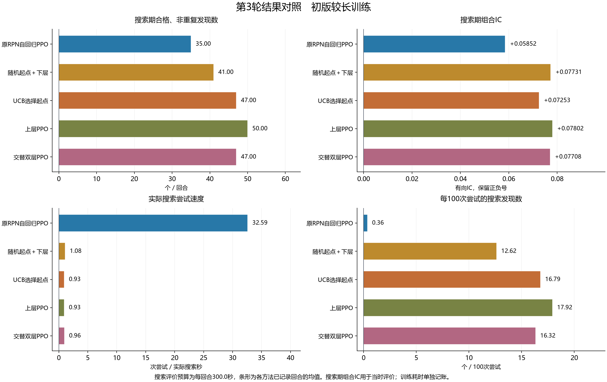
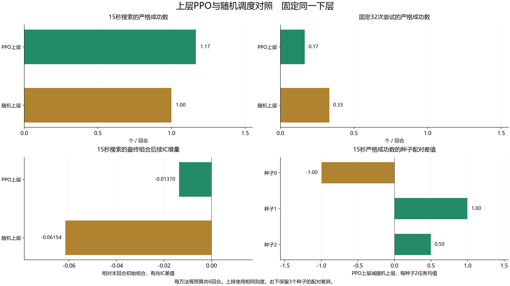
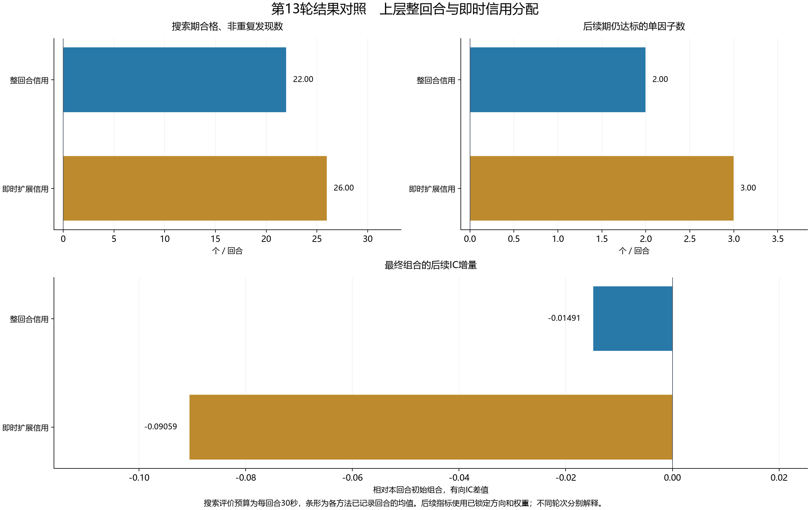
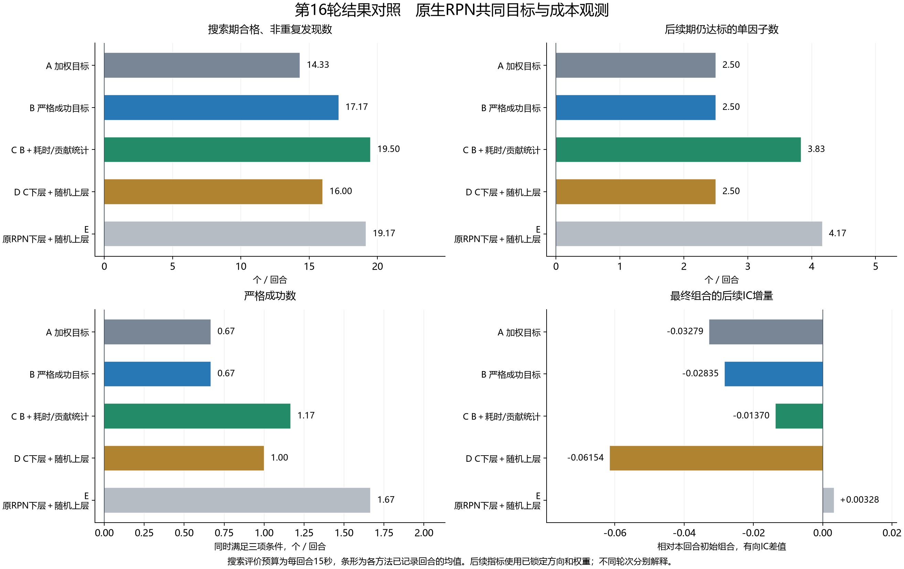
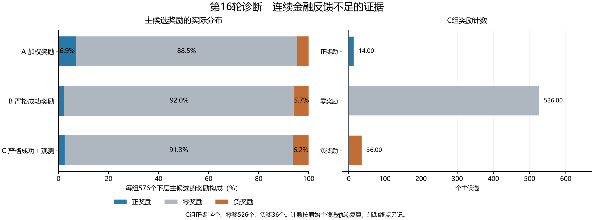

## 1. 训练

完整的双层PPO训练，随后扩大到399条起点、8个历史训练任务，延长训练、固定下层比较上层调度、修改两层奖励，以及AST改原生RPN的实验，后面的主要对照都用了3个训练种子。

原方案两层分别定义奖励。下层使用拟合期单因子成绩及终点续采样，上层使用新增有效因子数加组合IC改善。共同奖励是后续引入的实验修改，其结果按该变体解释。[原方案执行依据](双层PPO实现与实验说明_20261106.md)

## 2. 结果

300秒搜索，双层方法找到了50个合格、非重复因子，随机选择起点找到了41个，原RPN自回归PPO找到了35个。

 **每次尝试的命中率比较突出。** 双层方法每100次尝试找到约18个合格因子，原RPN约0.36个。围绕已有公式做编辑、再学习选择起点，这个方向值得继续做。

## 3. 瓶颈

### 单次搜索耗时过长

**一次选起点、编辑公式再完成评价，整个流程耗时太长。** 双层方法每秒只能尝试约0.93次，原RPN约32.59次。单次尝试质量提高，固定时间内能尝试的数量少很多。

后续改为RPN的扩散编辑。相比AST，完整搜索吞吐实测提高约7.3%，提速还有空间。

| 完整搜索指标     |  优化AST | 原生RPN扩散编辑 |
| ---------- | -----: | --------: |
| 每秒完成候选数    |   7.97 |      8.55 |
| 30秒平均完成候选数 | 241.33 |    256.92 |
### 上层调度的收益不稳定

**上层PPO还没有稳定选出比随机调度更有价值的起点。** 对比实验：最新C、D组共用同一个下层，只替换上层调度，每方法3个模型种子、2个开发任务。

| 上层调度    | 15秒成功数 | 固定32次成功数 | 15秒组合后续IC增量 |
| ------- | -----: | -------: | ----------: |
| C组PPO上层 |   1.17 |     0.17 |    −0.01370 |
| D组随机上层  |   1.00 |     0.33 |    −0.06154 |

15秒评价中PPO组有改善，但严格成功的三个种子差值为−1.00、＋1.00、＋0.50，固定32次尝试时成功数又更低。收益随种子和预算变化，上层奖励、任务观测和信用分配需要继续检查。[原始均值](../var/experiments/rpn_goal_alignment_20261110/comparison.csv) · [种子配对差值](../var/experiments/rpn_goal_alignment_20261110/paired_differences.json)

## 4. 继续修改算法

**搜索期合格的因子，加入后续组合未必有帮助。** 固定同一下层、只修改上层信用分配后，发现数从22提高到26，后续达标数从2提高到3，组合IC增量却从−0.01491降到−0.09059。（组合IC的计算方式有问题吗？）

说明，按发现数或单因子达标数挑方案，可能选出组合表现更差的方案。上层调度与下层奖励都需要检验后续组合贡献。

后续共同奖励实验中，改进组C的严格成功数为1.17，原有下层加随机调度的E组为1.67，整体优势还没有建立。

共同奖励变体的下层C组576个主候选中，526个获得零奖励，占91.3%。这一统计对应改版后的奖励。大量未达标候选收到相同反馈，需要检查这项改动的影响。（通过前置检查后，严格成功得＋1，损害组合则连续扣分，最多扣1分。前置检查未通过，直接得0。）

**现在需要解决三个问题，降低单次搜索成本、让上层调度产生稳定增量，以及把搜索命中率转化为后续组合价值。**

### 已完成的下层独立检验

固定随机上层，比较8种AST下层方案，共做96次评价，每次32次尝试。代表结果如下，均为每回合均值。

| 下层方法     | 搜索发现数 | 后续达标数 | 组合后续IC增量 |
| -------- | ----: | ----: | -------: |
| 随机合法编辑   |  3.50 |  0.50 | −0.00419 |
| 仅结构预训练   |  4.75 |  1.00 | −0.05822 |
| 金融PPO父下层 |  5.83 |  0.42 | −0.05039 |
**下层PPO提高了搜索发现数，后续价值的优势还没有建立。** 该诊断复用已有模型，结构组共用一个预训练初始化，金融组带有历史训练与检查点选择的影响。[实验设置](../var/experiments/architecture_study_20261109/lower_only/preregistration.json) · [全部结果](../var/experiments/architecture_study_20261109/lower_only/comparison.json)

## 5. 算法具体修改方向

**先按原方案分别检验两层。以下为后续提出的修改建议，仍需配对验证。**

### 下层PPO

- 按IC、RankIC和覆盖率距离门槛的程度给连续奖励，区分接近达标和明显不足。
- 将组合贡献引入下层作为单独实验项。接纳前试算组合，在多个成熟历史窗口评价增量与稳定性，方向和权重提前锁定，并与原单因子奖励配对比较。

### 上层PPO

以上层自身的新增有效因子数和组合改善奖励为基础，结合起点质量、成功率、耗时和当前组合，优化固定时间内的产出。耗时与贡献率输入分别检验。

固定同一下层后，若多种子结果仍持续落后随机和UCB，再调整状态表示、动作粒度和调度方式。

### 两层连接

原方案上层选起点，下层按单因子终点评分和续采样训练。共同终点评分属于后续实验变体，需单独验收。每步任务条件、下层更新后重新采集上层轨迹属于后续接口改进，同时检验它们能否改善编辑行为和组合价值。

### 怎样单独验证两层有没有用

| 要检验什么       | 固定什么           | 比较哪些方法                         |
| ----------- | -------------- | ------------------------------ |
| 下层金融PPO是否有用 | 随机上层、相同RPN编辑规则 | 随机合法编辑、仅结构预训练、原奖励PPO、新奖励PPO    |
| 上层PPO是否有用   | 同一个已训练下层       | 随机选起点、UCB、原上层PPO、修改后上层PPO      |
| 任务条件是否有用    | 初始化、奖励和训练预算    | 有条件与去掉条件的配对训练，另测更换组合后的动作与终点变化  |
| 联合更新是否有增量   | 已分别验证的上下层起点模型  | 固定两层、只续训下层、只续训上层、交替续训，记录更新量与成本 |
|             |                |                                |

下层的原、新奖励组从同一结构预训练模型出发，追加更新量相同。上层两组采用配对初始化及相同更新量。每项使用至少3个配对训练种子。固定尝试数检查候选质量，固定搜索时间检查实际产出，同时报告严格成功数和最终组合后续IC增量。

上述旧模型下层诊断、上层调度对照及条件敏感性检查已完成。下一轮要补新奖励的配对训练，以及最新原生RPN上的完整部件复验。先固定候选流检查评分，再做下层、上层和联合实验。用固定验证任务曲线判断是否值得追加训练，方向明确后在4060上扩大训练。

[完整训练与图文记录](双层PPO实验_完整记录_20261110.md) · [初版结果](../var/experiments/hierarchical_research_suite_20261106/training_seed_0/experiment_metrics.csv) · [RPN速度对照](../var/experiments/native_rpn_speed_20261110/speed_comparison.json) · [上层信用分配对照](../var/experiments/architecture_study_20261109/upper_credit/comparison.json) · [最新结果](../var/experiments/rpn_goal_alignment_20261110/comparison.csv)
