# 双层PPO因子生成研究逐轮训练汇报

本文件保留历史逐轮图文记录，供查阅原始结果与修订过程。课堂汇报使用[五轮重点稿](双层PPO实验.md)。第1、2轮为极小预算流程检查，早期训练计时包含本轮初始化准备，各项时间范围及实验限制以重点稿说明为准。

实验结果截至2026年11月10日。目标是在固定时间内，更快发现有效、非重复，并且对后续组合有增量价值的单因子。

以下按主要实验启动先后编号，每轮依次列出训练数据与配置、结果数据、分析和据此实施的修改。部分部件对照从共同父模型出发，各轮在配置中说明模型来源。

共同设备为本机Intel Core Ultra 5 225H、14核、约32GB内存，计算使用CPU。早期采用同步采集与学习进程，最新一轮最多6个单线程学习进程，云费用0元。下层负责编辑公式，上层负责选择起点。

第1—6轮按当时的缓存和配置记录，后续修复了部分数据与评价问题。每轮的分析保留当时发现的局限，比较时需结合该轮数据版本。

**阅读数值时请先看每轮预算。** 训练耗时与10/30/45/60/90/300秒搜索评价分开记账。早期结果表中的搜索期组合IC，后期的后续组合增量分别标注。严格成功要求搜索合格非重复、后续单因子达标、相对当时组合后续IC增量为正。指标详解放在附录F。

每轮结果表后附中文结果对照图和实际训练记录图。后续尚未训练的修改保留为计划。

## 第1轮训练　初版双层PPO短预算训练（11月6日）

### 1. 训练数据与配置

- 单次模型训练、单次搜索采样。拟合期为2022-01-04至2022-10-31，历史搜索反馈为2023-02-01至2023-12-01。
- 数据使用原行情缓存，500只股票、7字段、未来20日收益，1个历史训练任务。起点8条，结构语料64条。
- AST扩散编辑，每次4步，网络宽度32。完成结构预训练2轮、下层2批、上层1批、交替1批。
- 主模型记录训练耗时1.93分钟，含对照及评价的累计记录为3.84分钟。

### 2. 本轮结果数据

每次搜索10秒。下表为开发搜索期结果，组合IC列来自当次搜索期。

| 方法 | 搜索发现数 | 搜索期组合IC | 尝试数 |
|---|---|---|---|
| 原RPN自回归PPO | 5.00 | 0.14086 | 104.00 |
| 随机起点＋已训练下层 | 0.00 | -0.01383 | 14.00 |
| UCB选择起点 | 1.00 | 0.03174 | 13.00 |
| 上层PPO | 0.00 | -0.01383 | 14.00 |
| 交替双层PPO | 0.00 | -0.01383 | 15.00 |

### 本轮中文结果图

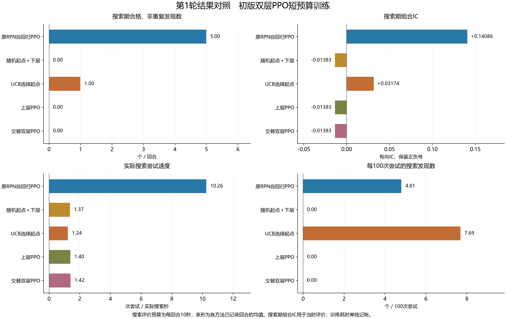

图中采用本轮实际记录的均值，计量口径和搜索预算与上方结果表一致。

**读图说明**　上面两图比较搜索发现数和搜索期组合IC，下面两图展示尝试速度与单次尝试产出。

### 本轮训练与验证图

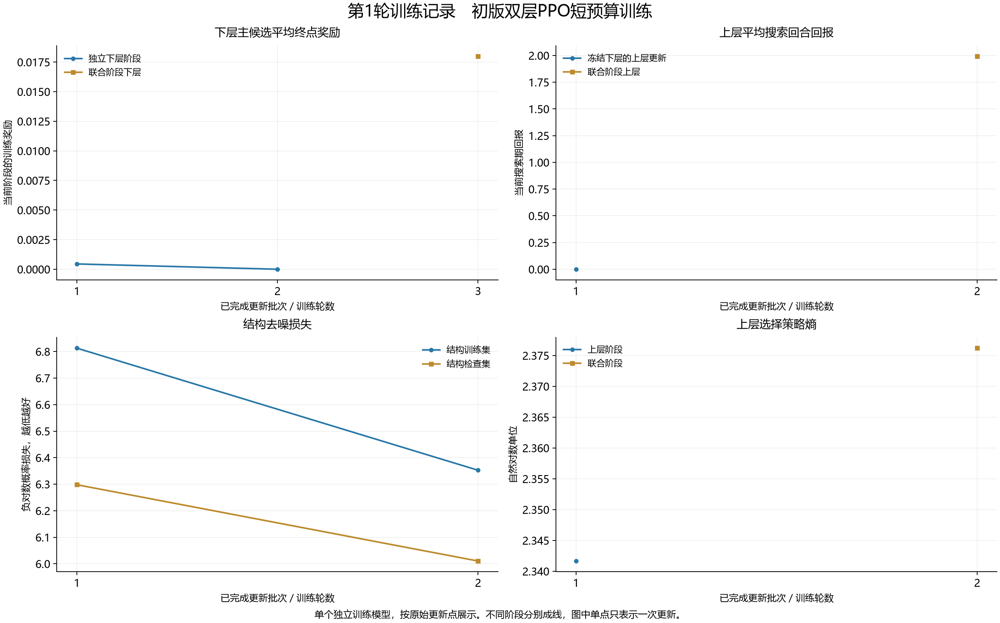

训练图按实际更新批次展示，单个模型的采样重复不计为独立训练种子。

### 3. 结果分析

10秒内上层PPO发现0个，原RPN发现5个。本轮更新量很少，说明完整流程能运行，尚未建立搜索效果优势。结构开发损失下降，也不能直接推出金融搜索有效。

### 4. 分析后实施的修改

优化下层条件采样和拟合期奖励入口，增加标量缓存、NEW起点排除和组合统计复用。在相同短预算下重新训练，形成第2轮。

[本轮配置](../var/experiments/hierarchical_fullcheck_20261106/resolved_config.json) · [本轮逐次结果](../var/experiments/hierarchical_fullcheck_20261106/experiment_metrics.csv)

## 第2轮训练　工程优化后同预算重训（11月6日）

### 1. 训练数据与配置

- 从头按第1轮短预算复测，训练数据、8条起点、64条结构语料及搜索预算相同。
- 数据使用原行情缓存，500只股票、7字段、未来20日收益，1个历史训练任务。起点8条，结构语料64条。
- AST扩散编辑，每次4步，网络宽度32。完成结构预训练2轮、下层2批、上层1批、交替1批。
- 主模型记录训练耗时2.45分钟，含对照及评价的累计记录为4.41分钟。

### 2. 本轮结果数据

每次搜索10秒。下表为开发搜索期结果，组合IC列来自当次搜索期。

| 方法 | 搜索发现数 | 搜索期组合IC | 尝试数 |
|---|---|---|---|
| 原RPN自回归PPO | 5.00 | 0.14086 | 106.00 |
| 随机起点＋已训练下层 | 0.00 | -0.01383 | 12.00 |
| UCB选择起点 | 1.00 | 0.03174 | 11.00 |
| 上层PPO | 0.00 | -0.01383 | 13.00 |
| 交替双层PPO | 0.00 | -0.01383 | 12.00 |

### 本轮中文结果图

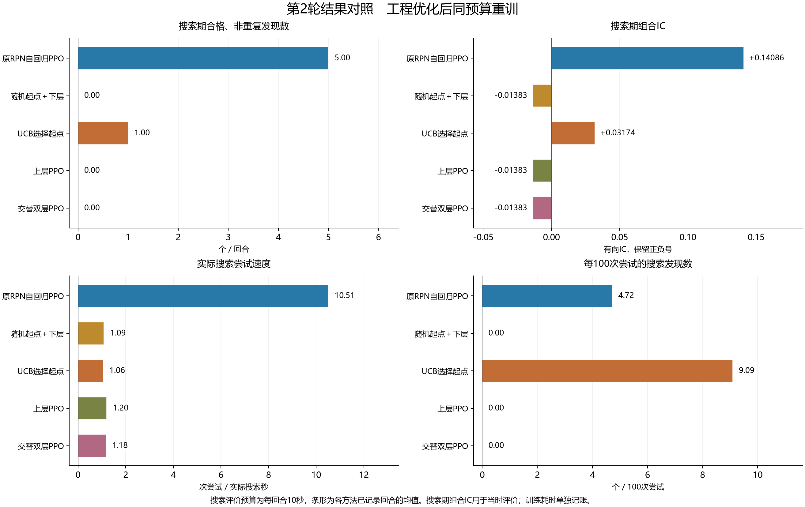

图中采用本轮实际记录的均值，计量口径和搜索预算与上方结果表一致。

**读图说明**　上面两图比较搜索发现数和搜索期组合IC，下面两图展示尝试速度与单次尝试产出。

### 本轮训练与验证图

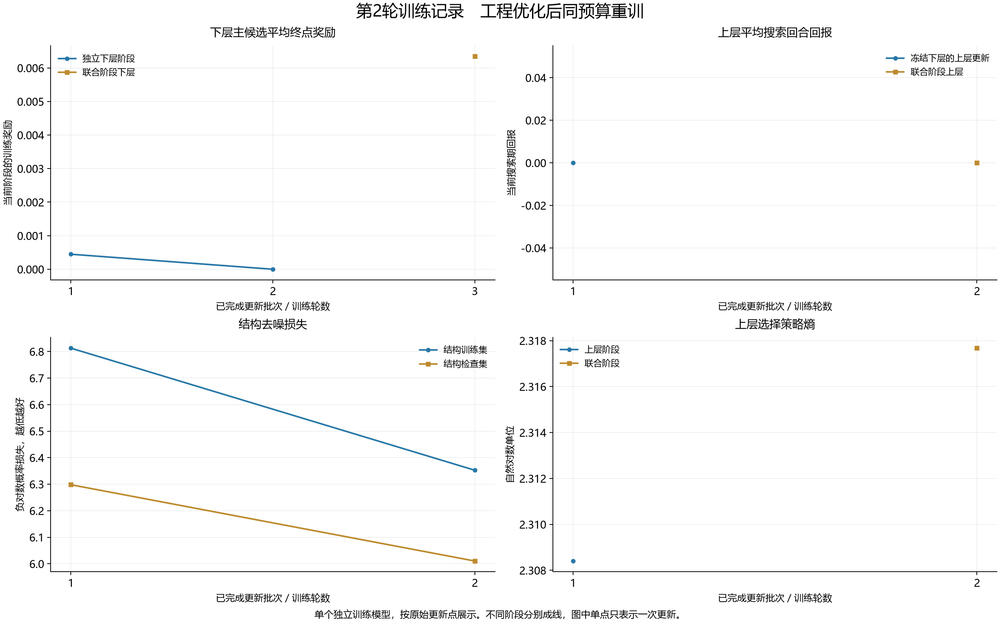

训练图按实际更新批次展示，单个模型的采样重复不计为独立训练种子。

### 3. 结果分析

上层PPO和交替PPO仍各发现0个，原RPN仍为5个。数值等价和局部加速没有转化为本轮新增因子收益。

### 4. 分析后实施的修改

将结构语料扩展到512条，增加预训练与金融PPO更新，并计划三个独立训练种子，进入第3轮较长训练。

[本轮配置](../var/experiments/hierarchical_fullcheck_optimized_20261106/resolved_config.json) · [本轮逐次结果](../var/experiments/hierarchical_fullcheck_optimized_20261106/experiment_metrics.csv)

## 第3轮训练　初版较长训练（11月6日）

### 1. 训练数据与配置

- seed 0已完成，seed 1在下层第40批暂停，seed 2尚未开始。下表仅使用已完成的seed 0。
- 数据使用原行情缓存，500只股票、7字段、未来20日收益，1个历史训练任务。起点16条，结构语料512条。
- AST扩散编辑，每次4步，网络宽度32。完成结构预训练10轮、下层128批、上层16批、交替4批。
- 主模型记录训练耗时217.02分钟，含对照及评价的累计记录为450.53分钟。

### 2. 本轮结果数据

每次搜索300秒。下表为测试搜索期结果，组合IC列来自当次搜索期。

| 方法 | 搜索发现数 | 搜索期组合IC | 尝试数 |
|---|---|---|---|
| 原RPN自回归PPO | 35.00 | 0.05852 | 9779.00 |
| 随机起点＋已训练下层 | 41.00 | 0.07731 | 325.00 |
| UCB选择起点 | 47.00 | 0.07253 | 280.00 |
| 上层PPO | 50.00 | 0.07802 | 279.00 |
| 交替双层PPO | 47.00 | 0.07708 | 288.00 |

### 本轮中文结果图

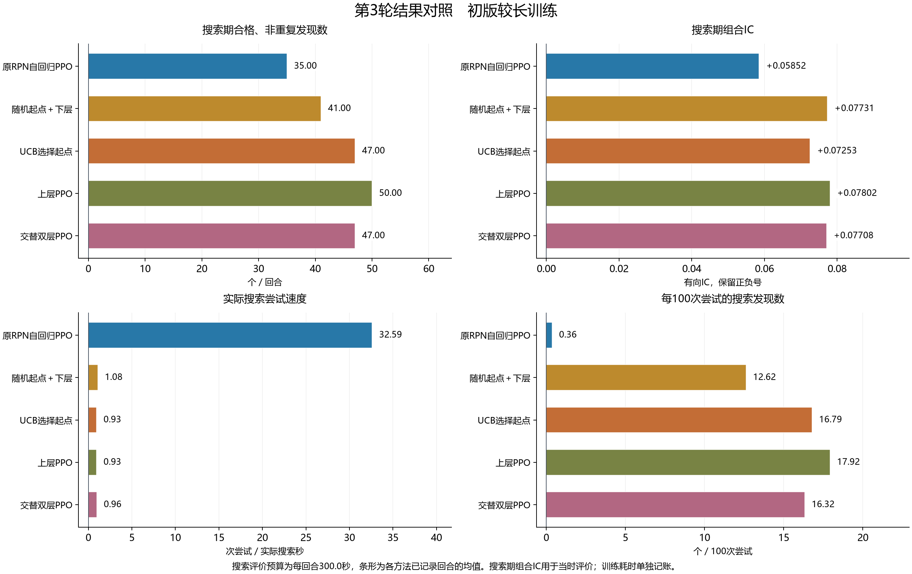

图中采用本轮实际记录的均值，计量口径和搜索预算与上方结果表一致。

**读图说明**　上面两图比较搜索发现数和搜索期组合IC，下面两图展示尝试速度与单次尝试产出。

### 本轮训练与验证图

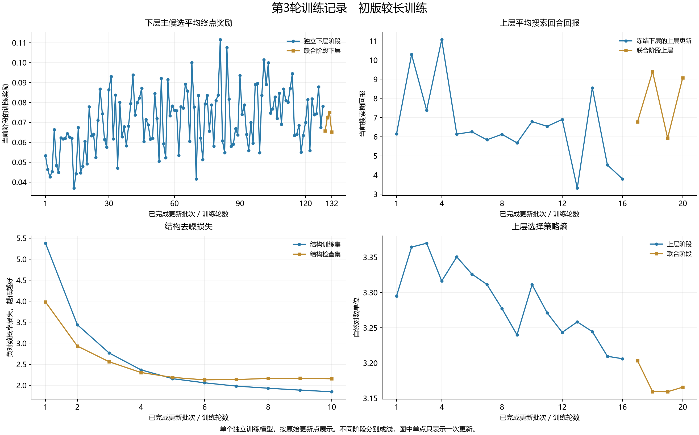

训练图按实际更新批次展示，单个模型的采样重复不计为独立训练种子。

### 3. 结果分析

300秒测试搜索中，上层PPO发现50个、随机起点41个，但只有一个完整模型和一次采样。起点仅16条，包含简单字段及等价表达式，后续数据复核也发现需要修正的口径。

### 4. 分析后实施的修改

停止未完成的旧训练并保存检查点。引入真实LLM产生且经历史IC与信号去重的402条起点，把2023年反馈分成3个任务，降低为2步编辑，并加入开发检查点选择。

[本轮配置](../var/experiments/hierarchical_research_suite_20261106/training_seed_0/resolved_config.json) · [本轮逐次结果](../var/experiments/hierarchical_research_suite_20261106/training_seed_0/experiment_metrics.csv)

## 第4轮训练　402条LLM起点的调优训练（11月6日）

### 1. 训练数据与配置

- 使用同一原行情缓存，拟合期为2022年，2023年分为3个反馈任务。402条起点来自1668条合法LLM候选的IC与相关性筛选，训练复用了结构初始化。
- 数据使用原行情缓存，500只股票、7字段、未来20日收益，3个历史训练任务。起点402条，结构语料512条。
- AST扩散编辑，每次2步，网络宽度32。完成结构预训练0轮、下层96批、上层24批、交替4批。
- 主模型记录训练耗时35.89分钟，含对照及评价的累计记录为86.24分钟。

### 2. 本轮结果数据

每次搜索90秒。下表为测试搜索期结果，组合IC列来自当次搜索期。

| 方法 | 搜索发现数 | 搜索期组合IC | 尝试数 |
|---|---|---|---|
| 原RPN自回归PPO | 10.00 | 0.05176 | 7187.00 |
| 随机起点＋已训练下层 | 10.00 | 0.06952 | 137.00 |
| UCB选择起点 | 15.00 | 0.09979 | 130.00 |
| 上层PPO | 13.00 | 0.07488 | 149.00 |
| 交替双层PPO | 14.00 | 0.07488 | 159.00 |

### 本轮中文结果图

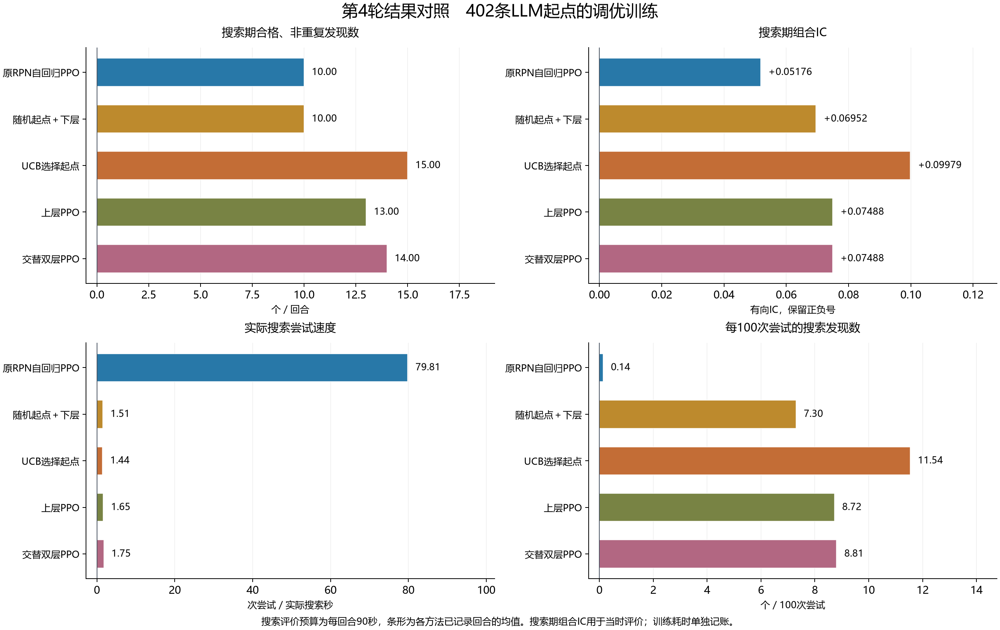

图中采用本轮实际记录的均值，计量口径和搜索预算与上方结果表一致。

**读图说明**　上面两图比较搜索发现数和搜索期组合IC，下面两图展示尝试速度与单次尝试产出。

### 本轮训练与验证图

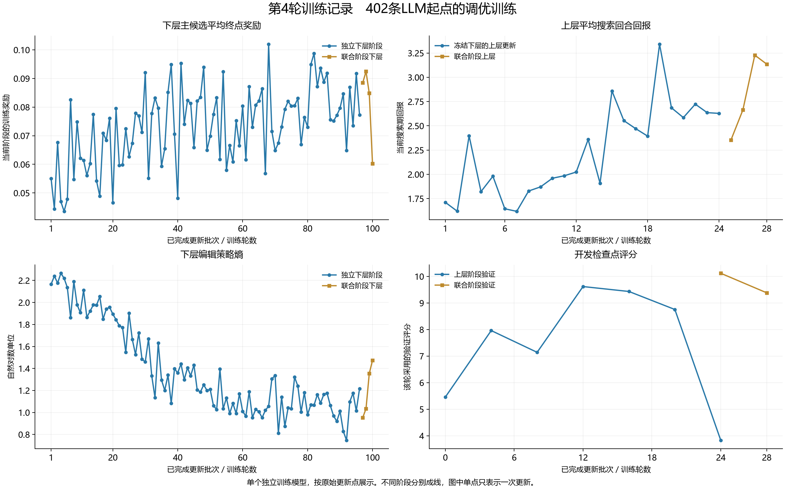

训练图按实际更新批次展示，单个模型的采样重复不计为独立训练种子。

### 3. 结果分析

90秒测试搜索中，上层PPO发现13个、交替14个，随机起点10个，UCB为15个。单模型结果尚未形成稳定调度优势。随后复核涉及生成缓存隔离、加载后随机数重置和公式合法性，旧结果单独保留。

### 4. 分析后实施的修改

修正生成结果跨方法缓存与随机状态等问题，重新验证起点库为401条，以相同96/24/4批训练量开展校正训练。

[本轮配置](../var/experiments/hierarchical_tuned_20261106/training_seed_0/resolved_config.json) · [本轮逐次结果](../var/experiments/hierarchical_tuned_20261106/training_seed_0/experiment_metrics.csv)

## 第5轮训练　401条起点的校正训练（11月7日）

### 1. 训练数据与配置

- 独立训练模型1个，每种方法做3次搜索采样。沿用2022年拟合和2023年3个反馈任务，起点重新验证为401条。
- 数据使用原行情缓存，500只股票、7字段、未来20日收益，3个历史训练任务。起点401条，结构语料512条。
- AST扩散编辑，每次2步，网络宽度32。完成结构预训练0轮、下层96批、上层24批、交替4批。
- 主模型记录训练耗时37.05分钟，含对照及评价的累计记录为121.61分钟。

### 2. 本轮结果数据

每次搜索60秒。下表为测试搜索期结果，组合IC列来自当次搜索期。

| 方法 | 搜索发现数 | 搜索期组合IC | 尝试数 |
|---|---|---|---|
| 原RPN自回归PPO | 11.33 | 0.06409 | 713.67 |
| 随机起点＋已训练下层 | 5.67 | 0.05306 | 73.00 |
| UCB选择起点 | 6.67 | 0.05630 | 68.33 |
| 上层PPO | 5.00 | 0.05950 | 68.33 |
| 交替双层PPO | 5.00 | 0.05950 | 67.67 |

### 本轮中文结果图

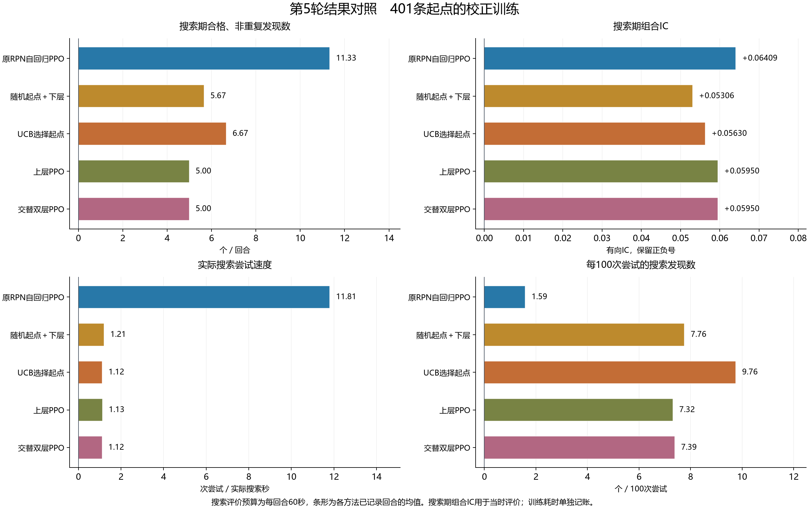

图中采用本轮实际记录的均值，计量口径和搜索预算与上方结果表一致。

**读图说明**　上面两图比较搜索发现数和搜索期组合IC，下面两图展示尝试速度与单次尝试产出。

### 本轮训练与验证图

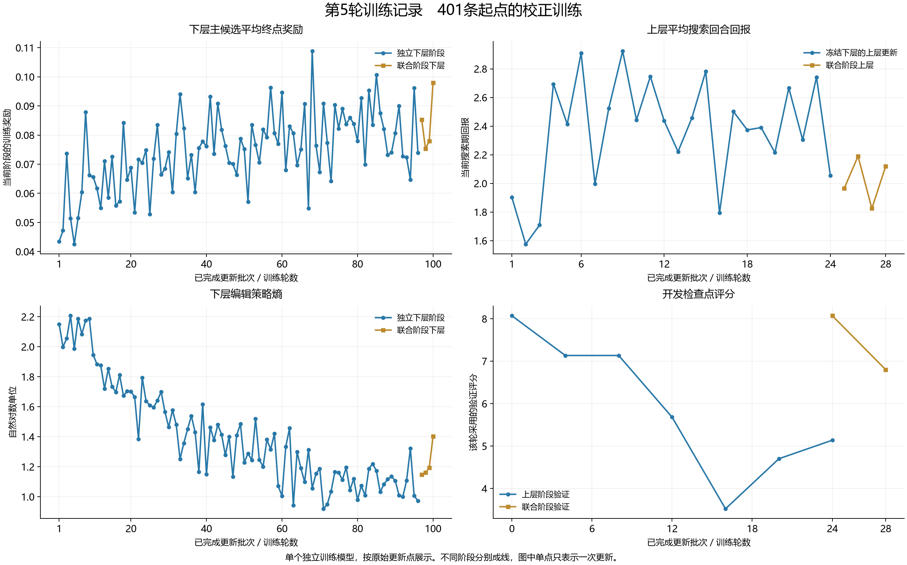

训练图按实际更新批次展示，单个模型的采样重复不计为独立训练种子。

### 3. 结果分析

60秒测试搜索中，上层PPO平均发现5.00个，低于UCB的6.67和原RPN的11.33。上层和交替阶段均选中第0次开发检查点，正式导出策略主要保留初始上层，训练奖励上升未迁移为开发优势。

### 4. 分析后实施的修改

在改进公共起点缓存和去重安全剪枝后，为上层Critic加入剩余预算，使用GAE，并增加累计回报上层对照，进入第6轮。

[本轮配置](../var/experiments/hierarchical_corrected_20261107/training_seed_0/resolved_config.json) · [本轮逐次结果](../var/experiments/hierarchical_corrected_20261107/training_seed_0/experiment_metrics.csv)

## 第6轮训练　缓存优化与GAE重训（11月7日）

### 1. 训练数据与配置

- 沿用401条起点、相同3个历史任务和结构初始化，重新执行金融训练。独立训练种子1个，每方法3个搜索采样。
- 数据使用原行情缓存，500只股票、7字段、未来20日收益，3个历史训练任务。起点401条，结构语料512条。
- AST扩散编辑，每次2步，网络宽度32。完成结构预训练0轮、下层96批、上层24批、交替4批。
- 主模型记录训练耗时44.30分钟，含对照及评价的累计记录为156.86分钟。

### 2. 本轮结果数据

每次搜索60秒。下表为测试搜索期结果，组合IC列来自当次搜索期。

| 方法 | 搜索发现数 | 搜索期组合IC | 尝试数 |
|---|---|---|---|
| 原RPN自回归PPO | 15.67 | 0.06567 | 1382.00 |
| 随机起点＋已训练下层 | 3.33 | 0.04006 | 47.67 |
| UCB选择起点 | 5.00 | 0.05270 | 47.33 |
| 上层PPO | 4.00 | 0.05451 | 47.67 |
| 交替双层PPO | 4.00 | 0.05451 | 47.33 |
| 累计回报上层对照 | 3.00 | 0.04596 | 46.33 |

### 本轮中文结果图

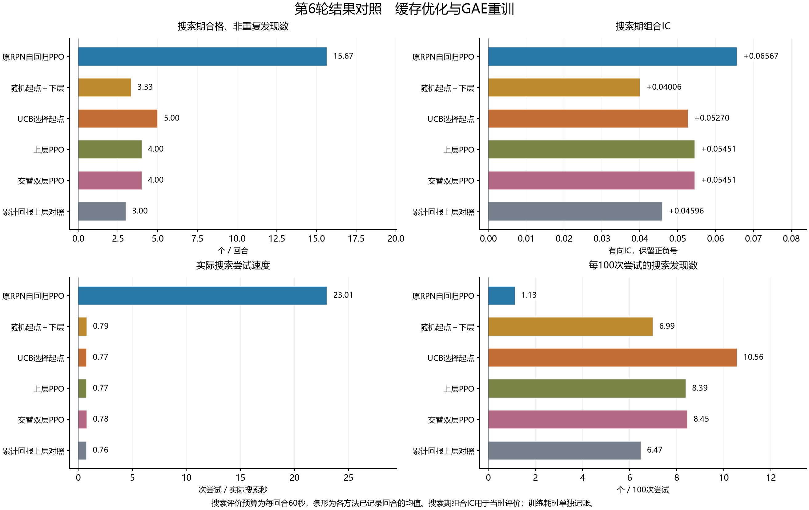

图中采用本轮实际记录的均值，计量口径和搜索预算与上方结果表一致。

**读图说明**　上面两图比较搜索发现数和搜索期组合IC，下面两图展示尝试速度与单次尝试产出。

### 本轮训练与验证图

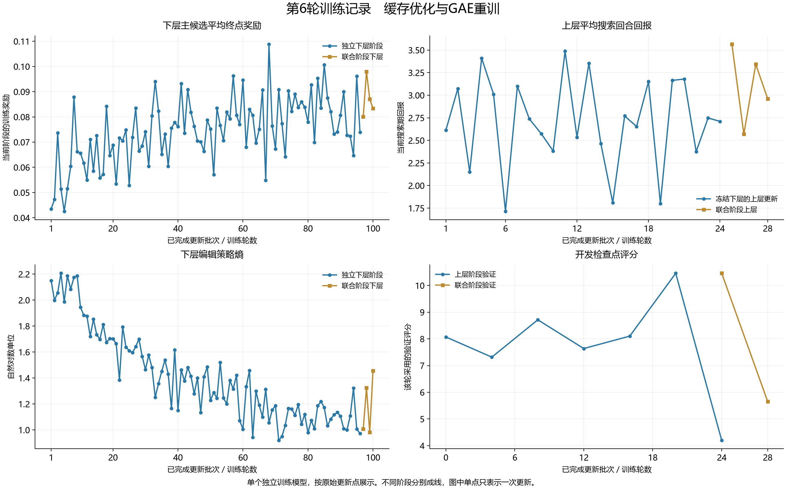

训练图按实际更新批次展示，单个模型的采样重复不计为独立训练种子。

### 3. 结果分析

60秒测试搜索中，上层GAE发现4.00个，累计回报对照3.00个，原RPN为15.67个。本轮上层结果仍缺乏稳定优势，单一模型和旧日历口径也限制判断。

### 4. 分析后实施的修改

复核交易日、20日标签成熟和库筛选时点，起点重验为399条。扩大为8个滚动训练任务、3个独立种子，同时加入更多简单调度对照，进入第7轮正式比较。

[本轮配置](../var/experiments/hierarchical_gae_20261107/training_seed_0/resolved_config.json) · [本轮逐次结果](../var/experiments/hierarchical_gae_20261107/training_seed_0/experiment_metrics.csv)

## 第7轮训练　399条起点、三种子的正式比较（11月8日）

### 1. 训练数据与配置

- 500只股票、7字段、20个正式交易日收益。8个滚动训练任务，每任务拟合120日、搜索评分60日，开发任务和测试任务各2个。
- 399条起点、512条结构语料。主模型3个独立种子，下层128批、上层48批、联合6批，AST编辑、上层GAE，并训练对应对照。
- 主模型有效金融训练约62.8—73.6分钟/种子，公共结构预训练另记。后续暂停后的累计wall字段含等待，采用有效金融训练记账。

### 2. 本轮结果数据

每次搜索45秒，以下为正式测试任务的种子均值。

| 方法 | 搜索发现数 | 后续达标数 | 后续组合IC增量 |
|---|---|---|---|
| 原RPN在线PPO | 11.42 | 0.50 | −0.02548 |
| 随机起点＋下层 | 7.58 | 0.33 | −0.06089 |
| UCB | 7.50 | 0.17 | −0.05463 |
| 上层GAE | 6.75 | 0.08 | −0.06636 |
| 交替双层 | 6.75 | 0.08 | −0.06651 |

### 本轮中文结果图

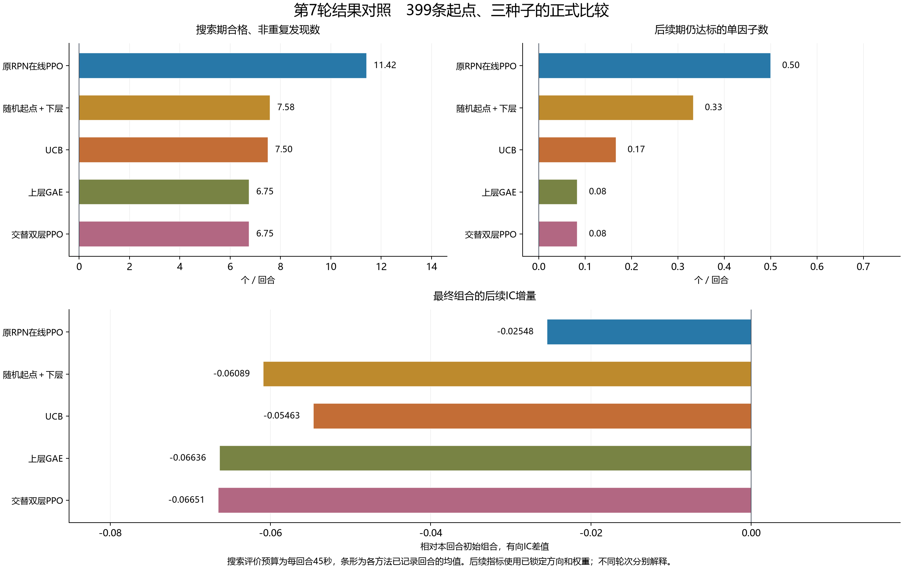

图中采用本轮实际记录的均值，计量口径和搜索预算与上方结果表一致。

**读图说明**　同时查看发现数量、后续达标与组合增量，组合增量零线区分相对改善和下降。

### 本轮训练与验证图

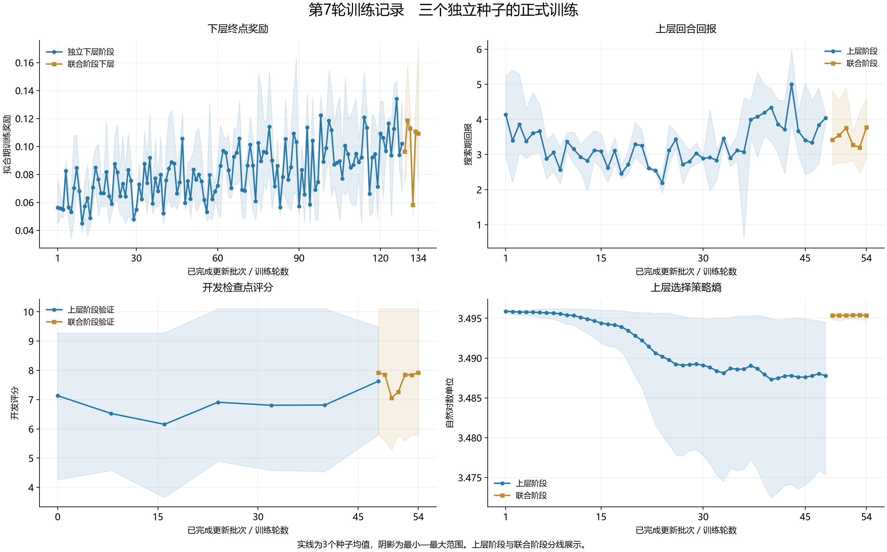

训练图使用保留的实际更新记录，阴影表示种子范围。各面板按各自奖励与验证口径阅读。

### 3. 结果分析

上层GAE发现6.75个，随机起点7.58个。18次联合候选全部回滚，其中13次同分，最终联合权重与冻结下层版本一致。上层回合仅约12—14次选择，重复扩展比例较低，难以充分经历试探与利用。

### 4. 分析后实施的修改

先冻结下层，将上层回合由15秒延长到45秒，学习率由0.0001提高到0.001，追加6批训练，检验短回合和更新强度是否限制学习。

[本轮分析](../var/experiments/budget_study_20261108/algorithm_assessment.md) · [本轮结果](../var/experiments/budget_study_20261108/final_comparison.csv)

## 第8轮训练　延长上层回合的继续训练（11月8日）

### 1. 训练数据与配置

- 复用第7轮三个父模型及相同数据、399条起点，冻结下层。
- 三个种子分别追加6批上层训练，每批6个45秒回合，学习率0.001。
- 追加训练约18.0—18.1分钟/模型。

### 2. 本轮结果数据

每次搜索45秒。

| 方法 | 搜索发现数 | 后续达标数 | 后续组合IC增量 |
|---|---|---|---|
| 原上层 | 6.75 | 0.08 | −0.06636 |
| 延长回合继续训练 | 7.33 | 0.25 | −0.06944 |
| 随机起点 | 7.58 | 0.33 | −0.06089 |

### 本轮中文结果图

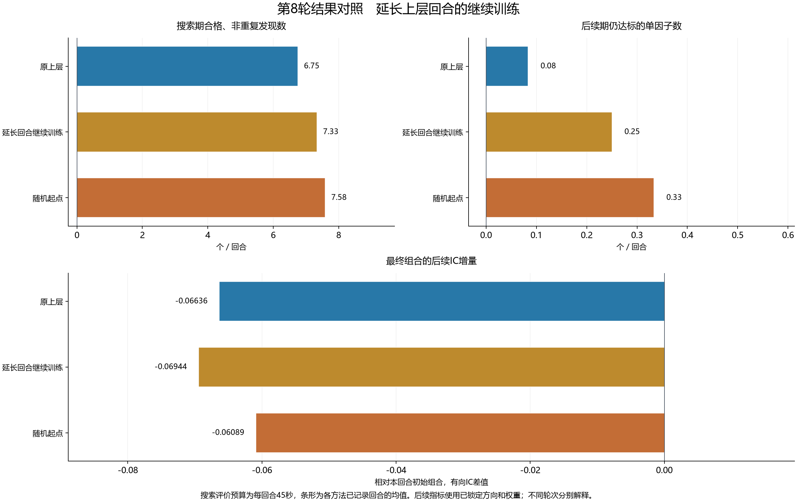

图中采用本轮实际记录的均值，计量口径和搜索预算与上方结果表一致。

**读图说明**　同时查看发现数量、后续达标与组合增量，组合增量零线区分相对改善和下降。

### 本轮训练与验证图

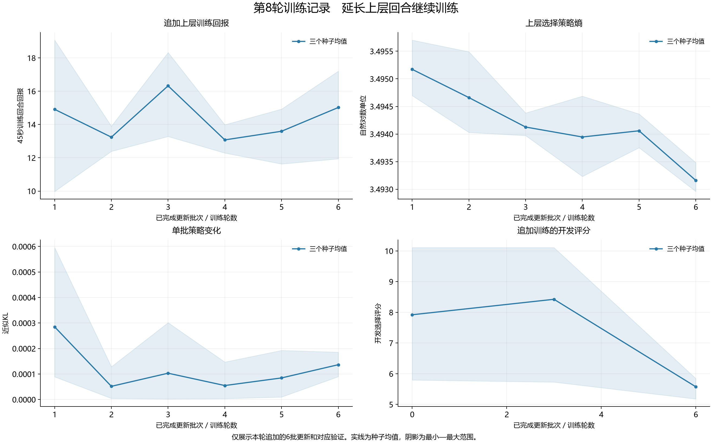

训练图使用保留的实际更新记录，阴影表示种子范围。各面板按各自奖励与验证口径阅读。

### 3. 结果分析

继续训练使发现数从6.75变为7.33，但仍低于随机起点7.58，后续组合增量从−0.06636变为−0.06944。该轮同时改变回合长度、学习率与训练量，结果只能评价这组调整整体。

### 4. 分析后实施的修改

进一步拆开上层学习率、联合回滚和工作模型积累，补充档案背景输入，并复核换手率缺失及标签，开展第9轮机制对照。

[继续训练设置](../var/experiments/budget_study_20261108/long_episode_study/preregistration.json) · [结果](../var/experiments/budget_study_20261108/final_comparison.csv)

## 第9轮训练　学习率、联合积累与档案背景机制对照（11月9日）

### 1. 训练数据与配置

- 沿用399起点与8个滚动任务，使用缺失值修复的参考数据。每组从同一种子的预算研究父模型出发。
- 6组×3种子，共18个模型。学习率和联合管理4组各16批，档案背景2组各8批，每批6回合、每回合48次尝试。共240个有效批。
- 本轮记录耗时9.9—48.9分钟/模型。受资源争用的旧运行及其废弃耗时另行隔离。

### 2. 本轮结果数据

每次搜索45秒，表中列出主要代表组。

| 方法 | 搜索发现数 | 后续达标数 | 后续组合IC增量 |
|---|---|---|---|
| 高学习率上层 | 23.50 | 2.50 | −0.07044 |
| 连续联合学习 | 22.67 | 3.00 | −0.03935 |
| 档案背景对照 | 22.00 | 3.17 | −0.04593 |
| 档案背景编码 | 25.50 | 2.17 | −0.01291 |
| 随机起点 | 24.17 | 3.00 | −0.00920 |
| 原RPN在线PPO | 37.50 | 6.00 | ＋0.00738 |

### 本轮中文结果图

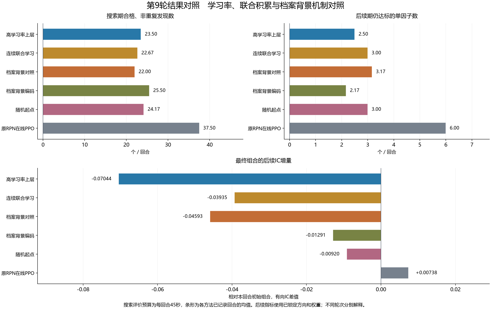

图中采用本轮实际记录的均值，计量口径和搜索预算与上方结果表一致。

**读图说明**　同时查看发现数量、后续达标与组合增量，组合增量零线区分相对改善和下降。

### 本轮训练与验证图

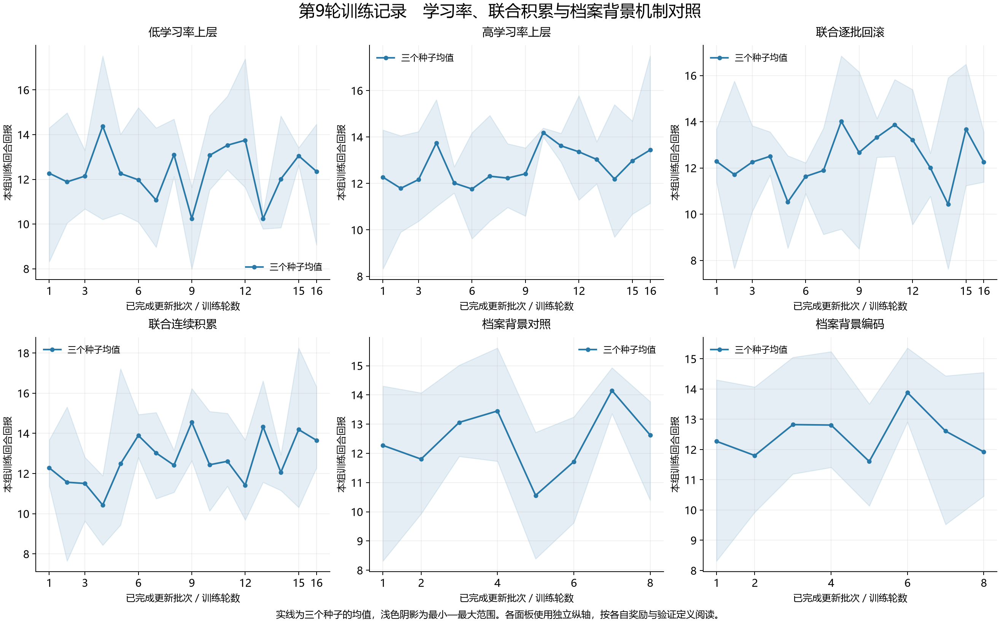

训练图使用保留的实际更新记录，阴影表示种子范围。各面板按各自奖励与验证口径阅读。

### 3. 结果分析

联合工作参数能够积累，但金融结果仍未超过原RPN。档案背景输入和提高学习率各有局部变化，未形成稳定综合优势。992项收益标签抽样复算误差为0，字段缺失修复也未消除跨期失效。

### 4. 分析后实施的修改

把上层奖励的反馈时期作为单独变量，冻结下层，只比较搜索期奖励和已经成熟的历史后续奖励，进入第10轮。

[机制分析与恢复记录](../var/experiments/mechanism_study_20261109/research_notes.md) · [逐组汇总](../var/experiments/mechanism_study_20261109/comparison.json)

## 第10轮训练　上层历史后续奖励对照（11月9日）

### 1. 训练数据与配置

- 沿用修复后的500股数据、399起点、8个历史任务。历史任务搜索段取20日，间隔后另取20日后续标签，并核验成熟时间。
- 2组×3种子，共6模型。冻结同一父下层，分别用搜索期奖励和历史后续奖励训练上层16批，每批6回合×48次尝试。
- 每模型追加记录耗时19.0—20.6分钟/模型。

### 2. 本轮结果数据

每次搜索45秒。

| 方法 | 搜索发现数 | 后续达标数 | 后续组合IC增量 |
|---|---|---|---|
| 搜索期奖励 | 22.33 | 2.50 | −0.06657 |
| 历史后续奖励 | 24.83 | 2.83 | −0.02677 |
| 随机起点 | 21.67 | 2.50 | −0.02152 |
| 原RPN在线PPO | 36.67 | 5.83 | ＋0.00738 |

### 本轮中文结果图

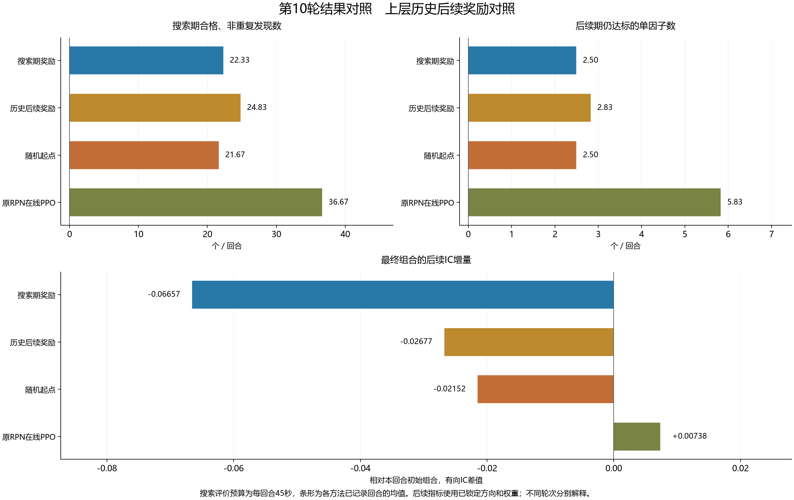

图中采用本轮实际记录的均值，计量口径和搜索预算与上方结果表一致。

**读图说明**　同时查看发现数量、后续达标与组合增量，组合增量零线区分相对改善和下降。

### 本轮训练与验证图

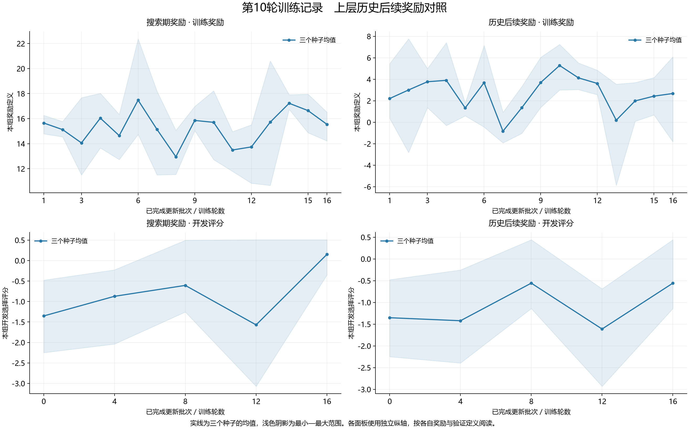

训练图使用保留的实际更新记录，阴影表示种子范围。各面板按各自奖励与验证口径阅读。

### 3. 结果分析

历史后续反馈减轻了平均组合损失，增量由−0.06657变为−0.02677，但整体仍落后于原RPN。只修改上层评价，无法保证下层生成器会针对当前组合产生新增价值。

### 4. 分析后实施的修改

将共同完成反馈下传到下层，并让起点与组合条件持续进入每步编辑，同时核验下层更新后重新采集上层，进入第11轮。

[训练设置](../var/experiments/forward_reward_study_20261109/preregistration.json) · [本轮结果](../var/experiments/forward_reward_study_20261109/comparison.json)

## 第11轮训练　两层共同完成反馈与持续任务条件（11月9日）

### 1. 训练数据与配置

- 沿用500股修复数据、399起点、8个滚动任务，三个方案均从同一种子的预算研究父模型初始化。
- 原接口、共同完成反馈、完成反馈＋持续任务条件，3组×3种子共9模型。各8批联合训练，先更新下层，再采上层。下层每批48个主候选，上层每批6回合×48次选择。
- 本轮追加记录耗时17.0—58.6分钟/模型。

### 2. 本轮结果数据

每次搜索45秒。

| 方法 | 搜索发现数 | 后续达标数 | 后续组合IC增量 |
|---|---|---|---|
| 原接口 | 21.83 | 2.17 | −0.04134 |
| 共同完成反馈 | 19.33 | 1.83 | −0.02188 |
| 完成反馈＋任务条件 | 22.33 | 2.33 | −0.04685 |
| 随机起点 | 22.17 | 2.83 | −0.02152 |

### 本轮中文结果图

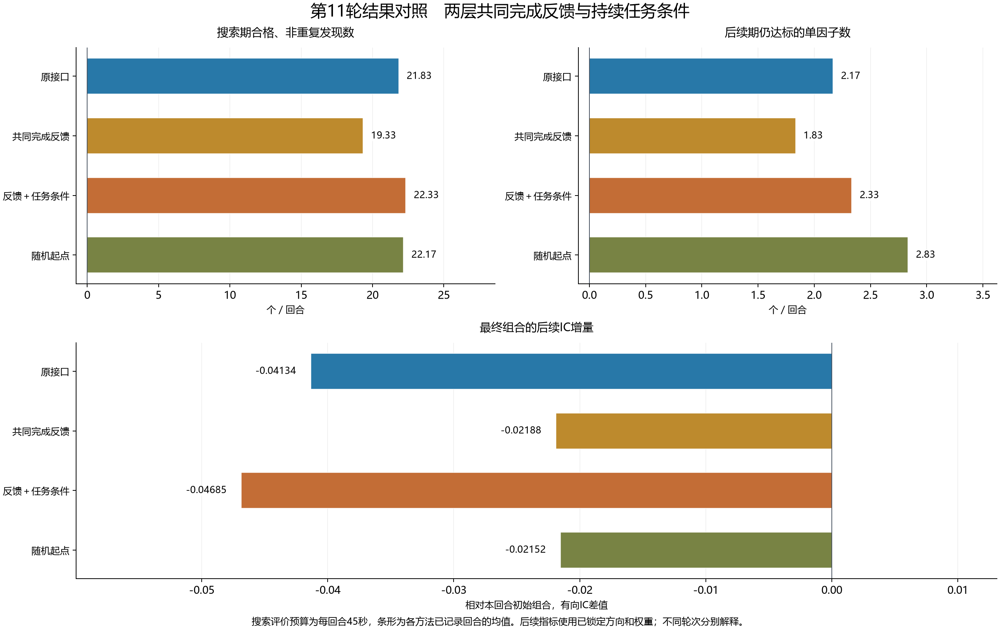

图中采用本轮实际记录的均值，计量口径和搜索预算与上方结果表一致。

**读图说明**　同时查看发现数量、后续达标与组合增量，组合增量零线区分相对改善和下降。

### 本轮训练与验证图

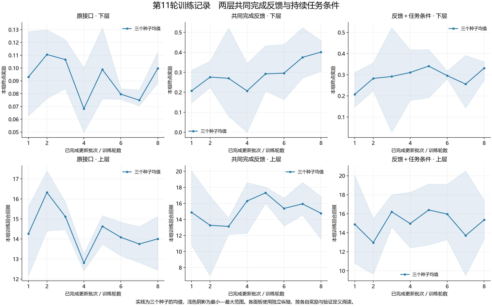

训练图使用保留的实际更新记录，阴影表示种子范围。各面板按各自奖励与验证口径阅读。

### 3. 结果分析

共同反馈组减轻部分组合损失，加入任务条件后没有稳定提高后续表现。72批联合更新、432回合和20736动作核验通过，但更换任务时动作总变差仅约0.02%—0.21%。原接口68条发现中14条无搜索组合增量，54条搜索改善中28条后续下降。

### 4. 分析后实施的修改

先保存模型并修正检查点统计，再分别检验下层、表示方式和上层信用分配。重新检查语料时发现旧512条中93条原式、2048条逆标签中907条不兼容，重建144条合法语料后开展第12、13轮。

[联合训练审计](../var/experiments/coordination_study_20261109/retained_training_audit.json) · [本轮结果](../var/experiments/coordination_study_20261109/comparison.json)

## 第12轮训练　AST与RPN序列编码对照（11月9日）

### 1. 训练数据与配置

- 500股数据、399起点，使用重建的144条结构语料，按家族分为96训练、24检查、24留出公式。
- AST与RPN编码各3种子，共6模型。两类编码器从配对初始化开始，结构预训练2轮、下层金融PPO 8批，每批32主候选。上层固定随机。RPN组此时仍共用树编辑执行核。
- 本轮记录耗时3.6—4.4分钟/模型。

### 2. 本轮结果数据

每次搜索30秒。

| 方法 | 搜索发现数 | 后续达标数 | 后续组合IC增量 |
|---|---|---|---|
| AST扩散编辑 | 19.33 | 3.50 | −0.05807 |
| RPN编码＋树编辑 | 17.17 | 4.50 | −0.04714 |
| 原RPN自回归PPO | 24.83 | 5.17 | −0.00030 |

### 本轮中文结果图

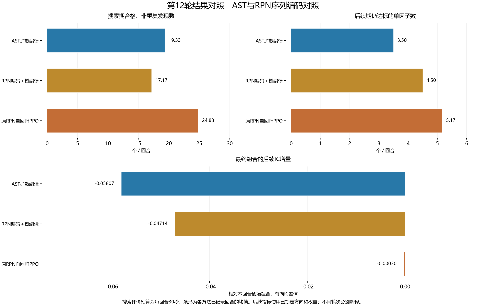

图中采用本轮实际记录的均值，计量口径和搜索预算与上方结果表一致。

**读图说明**　同时查看发现数量、后续达标与组合增量，组合增量零线区分相对改善和下降。

### 本轮训练与验证图

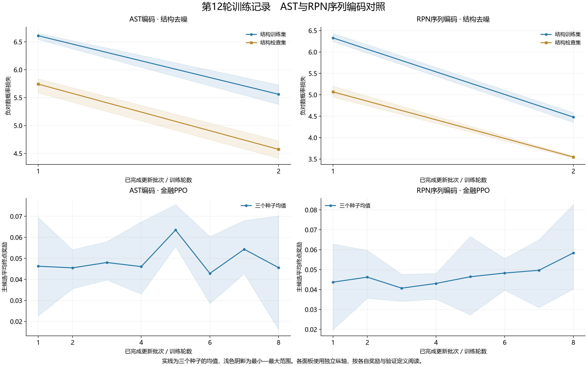

训练图使用保留的实际更新记录，阴影表示种子范围。各面板按各自奖励与验证口径阅读。

### 3. 结果分析

AST和RPN编码组平均尝试约144和142次，原RPN自回归为843次。仅更换编码器未解决生成耗时问题，也未建立金融优势。该轮识别了编码表示与编辑执行核需要分别检验。

### 4. 分析后实施的修改

登记原生token编辑为后续工程任务。同时用共同父下层单独检验上层信用分配，避免把生成器差异混入上层比较。

[表示对照设置](../var/experiments/architecture_study_20261109/representation/preregistration.json) · [本轮结果](../var/experiments/architecture_study_20261109/representation/comparison.json)

## 第13轮训练　上层整回合与即时信用分配（11月9日）

### 1. 训练数据与配置

- 沿用500股数据和399起点，从同一种子的预算研究父下层出发，冻结下层。与第12轮属于分别检验部件的对照。
- 整回合/GAE与即时扩展信用两组×3种子，共6模型，各8批上层更新，每批6回合×32次尝试。
- 本轮记录耗时5.1—7.0分钟/模型。

### 2. 本轮结果数据

每次搜索30秒。

| 方法 | 搜索发现数 | 后续达标数 | 后续组合IC增量 |
|---|---|---|---|
| 整回合信用 | 22.00 | 2.00 | −0.01491 |
| 即时扩展信用 | 26.00 | 3.00 | −0.09059 |

### 本轮中文结果图

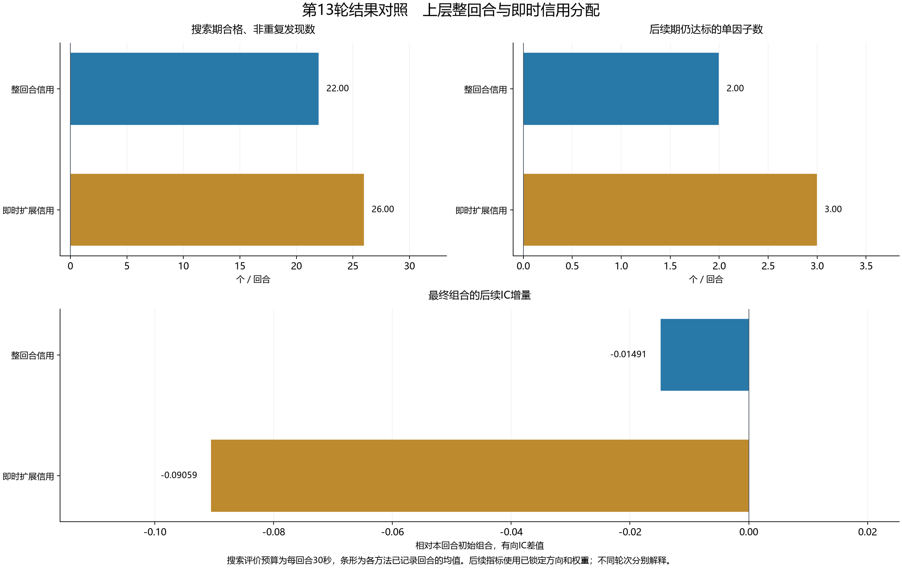

图中采用本轮实际记录的均值，计量口径和搜索预算与上方结果表一致。

**读图说明**　同时查看发现数量、后续达标与组合增量，组合增量零线区分相对改善和下降。

### 本轮训练与验证图

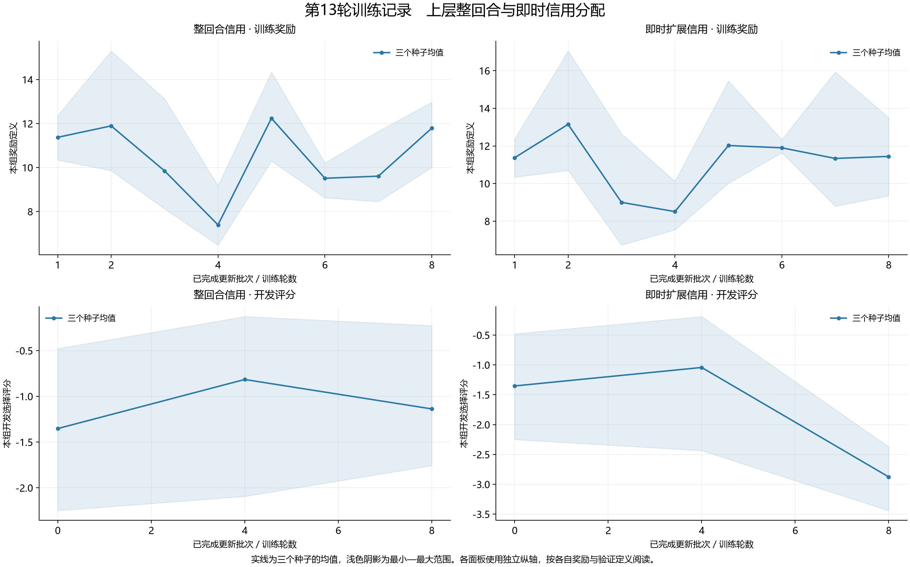

训练图使用保留的实际更新记录，阴影表示种子范围。各面板按各自奖励与验证口径阅读。

### 3. 结果分析

即时信用把发现数从22.00提高到26.00，但后续组合增量从−0.01491恶化到−0.09059。更直接追逐当前扩展成果，没有解决跨期价值问题。

### 4. 分析后实施的修改

优先检验下层完成反馈的时期，固定随机上层，用成熟历史后续终点重算下层奖励，进入第14轮。

[信用分配设置](../var/experiments/architecture_study_20261109/upper_credit/preregistration.json) · [本轮结果](../var/experiments/architecture_study_20261109/upper_credit/comparison.json)

## 第14轮训练　下层搜索期与历史后续完成反馈（11月9日）

### 1. 训练数据与配置

- 沿用500股、399起点和成熟历史后续任务，仍使用AST下层。两组从相同预算研究父模型出发，上层固定随机。
- 2组×3种子，共6模型，各8批下层PPO，每批32个主候选和24个辅助终点，学习率0.0003，PPO每批4轮。
- 本轮记录耗时3.6—3.9分钟/模型。

### 2. 本轮结果数据

每次搜索30秒。

| 方法 | 搜索发现数 | 后续达标数 | 严格成功数 | 后续组合IC增量 |
|---|---|---|---|---|
| 搜索期完成反馈 | 30.33 | 4.83 | 1.67 | −0.06560 |
| 历史后续完成反馈 | 23.50 | 3.00 | 1.17 | −0.01025 |
| 父下层＋随机上层 | 23.50 | 3.00 | 1.67 | −0.02767 |

### 本轮中文结果图

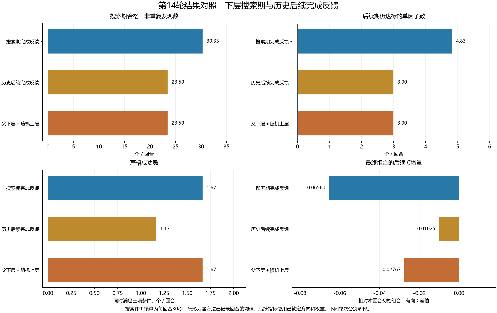

图中采用本轮实际记录的均值，计量口径和搜索预算与上方结果表一致。

**读图说明**　同时查看发现数量、后续达标与组合增量，组合增量零线区分相对改善和下降。

### 本轮训练与验证图

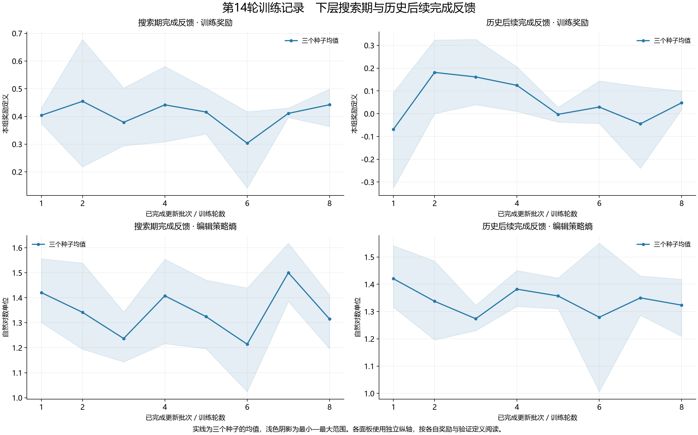

训练图使用保留的实际更新记录，阴影表示种子范围。各面板按各自奖励与验证口径阅读。

### 3. 结果分析

历史后续反馈将组合增量从−0.06560改善到−0.01025，但严格成功由1.67降至1.17，加权得分改善与严格目标发生差异。另发现重复子表达式在不同位置被原Actor强制同分。

### 4. 分析后实施的修改

在相同历史后续奖励和训练预算下加入位置身份，零初始化迁移旧参数，单独检验位置条件的金融价值，进入第15轮。

[下层反馈设置](../var/experiments/architecture_study_20261109/lower_forward/preregistration.json) · [严格成功结果](../var/experiments/architecture_study_20261109/lower_forward/strict_value_summary.json)

## 第15轮训练　编辑位置身份对照（11月9日）

### 1. 训练数据与配置

- 与第14轮使用相同父模型、数据、历史后续反馈和随机上层。比较原输入与新增深度/子节点角色位置向量。
- 2组×3种子，共6模型，各8批下层PPO，每批32主候选及24辅助终点。
- 本轮记录耗时3.4—3.7分钟/模型。

### 2. 本轮结果数据

每次搜索30秒。

| 方法 | 搜索发现数 | 后续达标数 | 严格成功数 | 后续组合IC增量 |
|---|---|---|---|---|
| 位置对照 | 22.83 | 3.00 | 1.17 | −0.02671 |
| 位置身份输入 | 20.83 | 2.00 | 0.83 | −0.04599 |
| 父下层＋随机上层 | 22.00 | 2.50 | 1.50 | −0.02152 |

### 本轮中文结果图

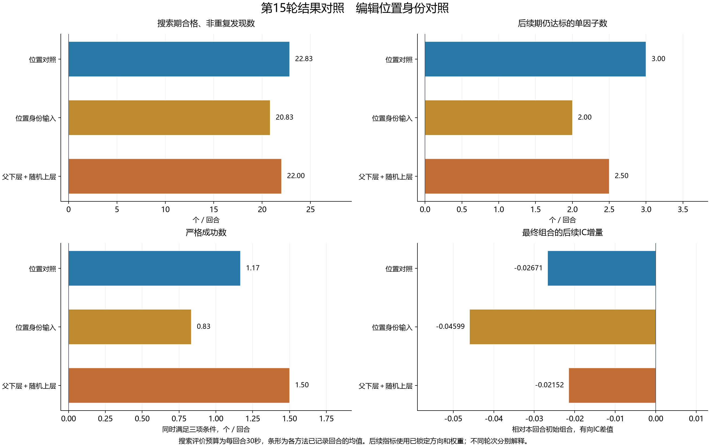

图中采用本轮实际记录的均值，计量口径和搜索预算与上方结果表一致。

**读图说明**　同时查看发现数量、后续达标与组合增量，组合增量零线区分相对改善和下降。

### 本轮训练与验证图

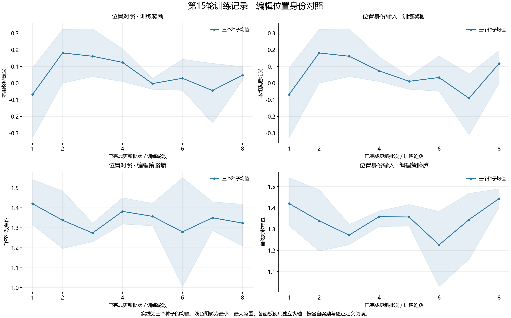

训练图使用保留的实际更新记录，阴影表示种子范围。各面板按各自奖励与验证口径阅读。

### 3. 结果分析

位置身份解除同内容不同位置的强制同分约束，但30秒严格成功由对照1.17变为0.83。表达能力修复已经核验，金融收益仍需独立证明。

### 4. 分析后实施的修改

根据第12轮尚未完成的执行核问题，实现真正的原生RPN token编辑、原生训练轨迹与缓存优化，并先做下述工程对照。

[位置对照设置](../var/experiments/architecture_study_20261109/position_context/preregistration.json) · [严格成功结果](../var/experiments/architecture_study_20261109/position_context/strict_value_summary.json)

## 第15轮之后的工程验证　原生RPN编辑（11月10日）

### 1. 使用的模型与数据

复用第12轮已训练的AST/RPN模型，使用同一500股面板和399起点。金融权重直接迁移，重点比较树编辑与原生token编辑执行路径。完成288组微基准与72次完整搜索试验。

### 2. 工程验证结果

| 指标 | 优化AST | 原生RPN |
|---|---|---|
| 两步冷缓存推理，毫秒/候选 | 52.216 | 29.078 |
| 30秒平均完整候选 | 241.33 | 256.92 |
| 完整候选/秒 | 7.97087 | 8.55133 |

### 工程验证中文图片

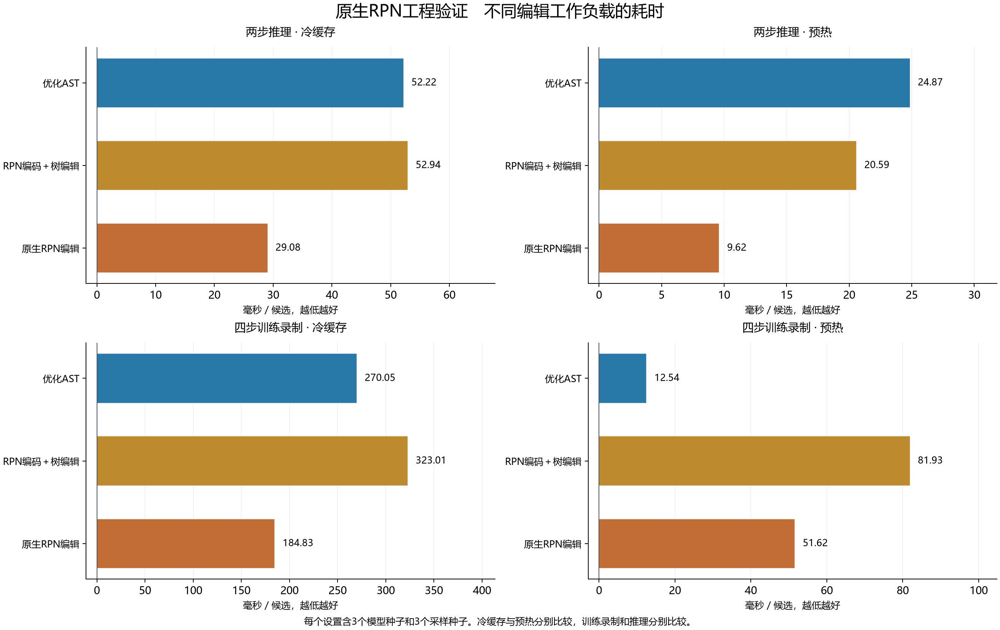

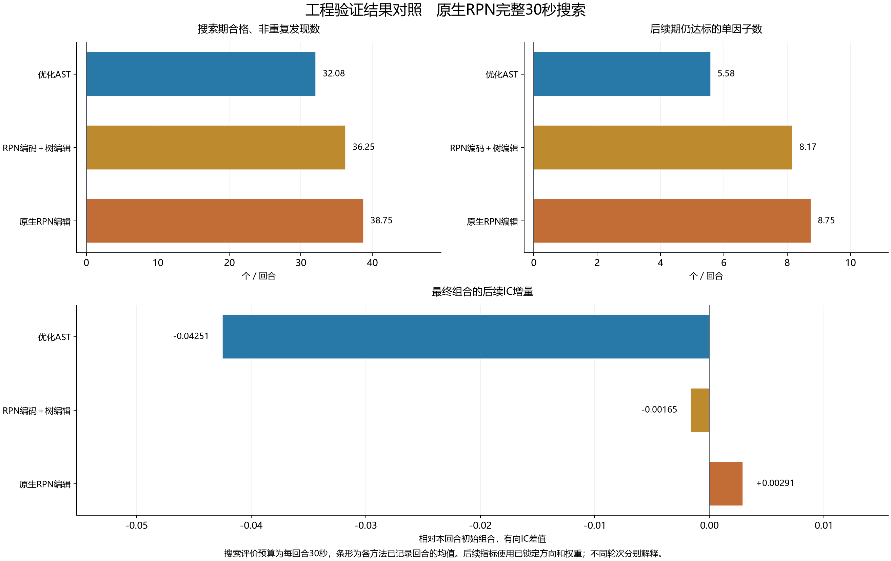

不同编辑步数、录制方式和缓存状态分别展示，速度结论以同场景比较解释。

### 3. 分析

完整吞吐提升约7.3%。同权重RPN树后端与原生后端的固定32次候选流和金融结果一致。四步录制预热有缓存慢点，说明速度排序取决于工作负载，完整搜索1.2至2倍的早期预测偏高。

### 4. 验证后实施的修改

正式入口改为原生RPN编辑，上下层均采用RPN编码。将原生动作缓存从40000提高到80000，并统一两层终点目标、修复独立下层训练入口、统一下层更新后重采上层。随后执行第16轮金融训练。

[逐次速度数据](../var/experiments/native_rpn_speed_20261110/speed_trials.csv)

## 第16轮训练　原生RPN共同目标与成本观测（11月10日）

### 1. 训练数据与配置

- 从第12轮RPN训练模型迁移到原生编辑后端，使用500股、399起点、144条合法结构语料、8个滚动任务，开发评价为2024年两个时期。
- A加权目标、B严格成功目标、C严格成功＋耗时/贡献统计，3组×3种子共9模型。另评价D为C下层＋随机上层，E为原有RPN父下层＋随机上层。
- 每模型4批独立下层、4批冻结下层的上层、2批联合更新，合计下层6次、上层6次。每模型192个下层主候选、96个辅助终点，上层共12个8秒回合。
- 单模型记录耗时4.6—7.4分钟/模型，最多6个学习进程并行，9模型主训练总墙钟约12分钟。

### 2. 本轮结果数据

每方法3种子×2开发任务，共6回合。15秒结果如下，固定32次结果见附录B。

| 方法 | 搜索发现数 | 后续达标数 | 严格成功数 | 后续组合IC增量 |
|---|---|---|---|---|
| A 加权目标 | 14.33 | 2.50 | 0.67 | −0.03279 |
| B 严格成功目标 | 17.17 | 2.50 | 0.67 | −0.02835 |
| C B＋耗时/贡献统计 | 19.50 | 3.83 | 1.17 | −0.01370 |
| D C下层＋随机上层 | 16.00 | 2.50 | 1.00 | −0.06154 |
| E 原有RPN下层＋随机上层 | 19.17 | 4.17 | 1.67 | ＋0.00328 |

C和E在6回合中分别获得7次和10次严格成功，对应均值1.17和1.67。

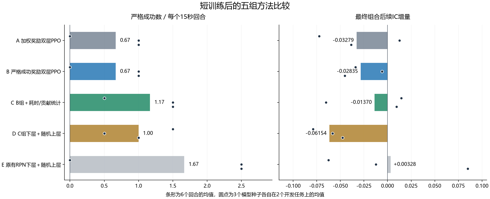

### 本轮中文结果图

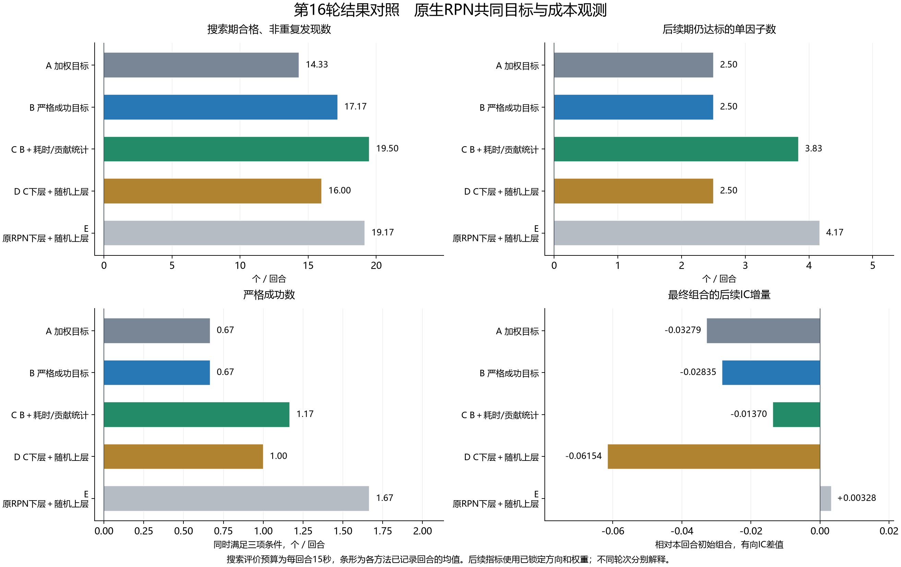

图中采用本轮实际记录的均值，计量口径和搜索预算与上方结果表一致。

**读图说明**　同时查看发现数量、后续达标与组合增量，组合增量零线区分相对改善和下降。

### 本轮训练与验证图

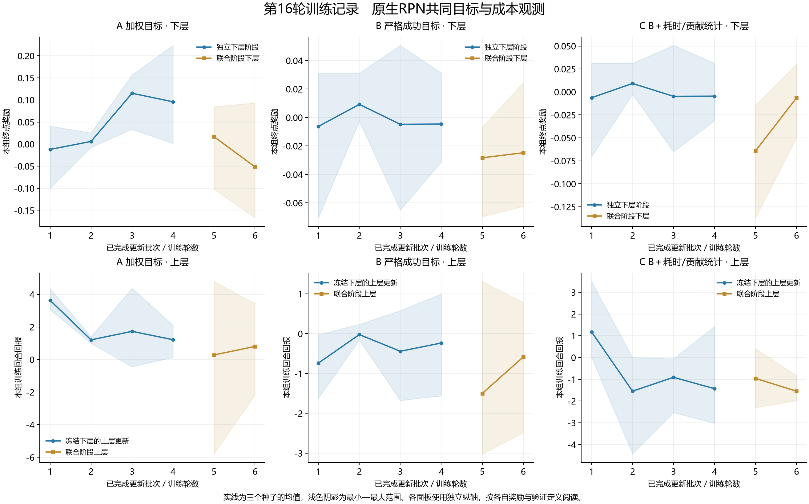

训练图使用保留的实际更新记录，阴影表示种子范围。各面板按各自奖励与验证口径阅读。

### 本轮奖励分布图

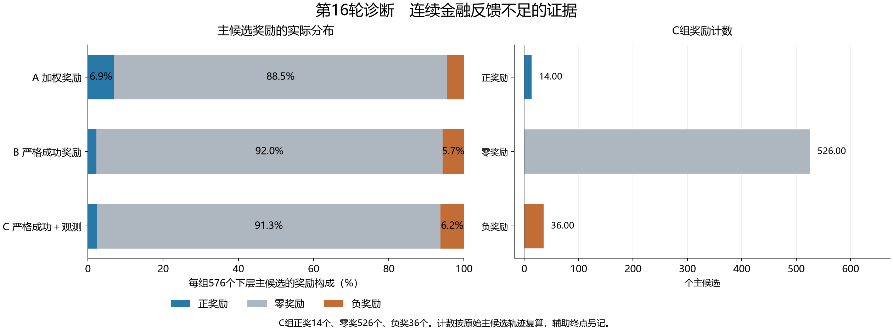

C组576个主候选中526个获得零奖励，占91.3%，为后续连续奖励方案提供了具体诊断依据。

### 3. 结果分析

B相对A严格成功相同。C相对B多0.50次，仍低于E的1.67次，最终组合增量也较低。C与D的种子差值分化，固定32次时C反而较低。C下层576主候选中14条正奖、36条负奖、526条零奖，零奖励占91.3%。任务连接有效，但换组合的动作总变差约0.12%，上层仍接近均匀选择。

### 4. 分析后形成的待验证修改

目前完成的是上述A/B/C实现与训练。连续质量裕量、多历史窗口组合贡献及接纳前试算已形成下一轮讨论方案，尚待完整奖励定义和配对验证。下一节列出其待验证内容。

[最新训练配置](../var/experiments/rpn_goal_alignment_20261110/preregistration.json) · [最新全部均值](../var/experiments/rpn_goal_alignment_20261110/comparison.csv) · [本轮训练审计](../var/experiments/rpn_goal_alignment_20261110/paired_initial_and_update_audit.json)

## 第16轮分析后提出的下一轮修改计划


以下为第16轮分析后提出的修改方向，尚未开展对应的新训练。

### 1. 对未达标候选提供连续的质量反馈

单因子质量可以按距离IC、RankIC和覆盖率门槛的程度评分。以IC门槛0.02为例，连续裕量可写为

\[
m_{IC}=\frac{IC_{\mathrm{有向}}-0.02}{0.02}.
\]

IC为0.019时裕量为−0.05，IC为0.001时为−0.95。这样可以区分接近达标和明显不足的候选。完整奖励还需同时处理组合损害、重复和数值无效情况。

固定时长任务还需检验逐次负奖的影响。失败每次都扣相同分数，可能使上层通过减少尝试来减少扣分，因此连续化需要结合时间预算目标设计。

### 2. 在多个成熟历史窗口中计算组合边际贡献

对候选的试算组合，在各个已经成熟的历史验证窗口计算

\[
d_j=IC_j(\text{试算组合})-IC_j(\text{原组合}).
\]

一个待验证的连续组合贡献项为

\[
G=\operatorname{mean}(d_j)-\lambda\operatorname{std}(d_j).
\]

前一项衡量平均改善，后一项体现对跨窗口不稳定性的惩罚。方向和权重提前拟合并锁定，\(\lambda\)需通过配对实验确定。这个G属于候选训练评分方案，尚未用于本轮训练。

还需要在接纳前计算试算组合，才能为被拒绝候选提供连续反馈。加入或替换方案应按事先约定、仅依赖当时可见数据的规则确定。

### 3. 按部件依次验证

| 顺序 | 最小实验 | 通过后才能回答的问题 |
|---|---|---|
| 第一步 | 固定已有候选流，回放连续质量与组合评分 | 新反馈能否区分有价值、接近门槛和有害候选 |
| 第二步 | 固定随机上层，只比较下层奖励 | 下层是否学到更好的生成行为 |
| 第三步 | 冻结同一下层，分别加入耗时、贡献率及两者 | 上层哪项输入实际有帮助 |
| 第四步 | 联合训练并记录固定验证任务曲线 | 改善能否积累，以及是否值得追加训练 |

各阶段同时核对严格成功数量和最终组合表现，再决定后续训练规模。


## 当前结论

原生RPN已获得约7.3%的完整搜索吞吐收益。最新金融训练的改进组严格成功均值1.17，父RPN随机上层为1.67，整体优势尚未建立。连续金融反馈与组合接纳是下一轮要按部件验证的方向。

## 附录A　最新实验的训练与评价协议

### A.1 训练预算

| 项目 | 设置 |
|---|---|
| 训练组 | A、B、C各3个配对种子，共9个模型 |
| 初始化 | 同一种子使用同一已训练RPN父下层，上层RPN编码器复用下层编码器，策略头配对初始化 |
| 独立下层训练 | 4批，每批32个主候选，2步编辑，8个状态各增加2个辅助终点 |
| 冻结下层的上层训练 | 4批，每批2个8秒搜索回合 |
| 联合训练 | 2批，每批先更新下层，再采集2个8秒上层回合 |
| PPO设置 | 每批4轮，批大小32，学习率0.0003，上层GAE参数0.95 |
| 总更新数 | 每模型6次下层更新、6次上层更新，共54次下层及54次上层更新 |
| 训练执行 | 最多6个独立单线程进程，无嵌套采集器 |
| 评价 | 五种方法各做固定32次和固定15秒评价，共60个回合 |
| 检查点 | 使用固定最终更新，开发期用于本轮结果评价 |

各组开始时使用相同随机种子，更新及KL停止后随机流和任务选择可能分化。首批行为另行审计。下层动作价值采用固定当前动作后的真实续采样终点均值，辅助分支只用于训练，主候选参与搜索接纳。

### A.2 数据和门槛

500股票面板，公共历史起点库399条，合法结构语料144条。训练使用8个rolling任务，拟合期从2022年延伸至2024年初，搜索与成熟后续标签覆盖2023年至2024年5月。训练标签实际结束日早于最早开发搜索日。

| 开发任务 | 搜索期 | 后续检验期 |
|---|---|---|
| dev_0 | 2024-07-01至2024-08-09 | 2024-09-09至2024-10-29 |
| dev_1 | 2024-09-02至2024-10-08 | 2024-11-06至2024-12-03 |

主要门槛为有向IC至少0.02、有向RankIC至少0.01、覆盖率至少0.8，工作组合容量为5，相关性门槛0.98。其余拟合期检查和去重规则保存在配置中。

开发时期已反复使用，任务之间存在时间依赖。三个模型种子描述训练随机性，不能据此认定跨市场稳定性。完整时点股票池和数据PIT尚未认证。

模型载入、公共信号准备及事后后续评价位于15秒搜索预算外。预算内包括回合初始化、起点选择、扰动、编辑、主候选计算、去重、组合更新及日志。超时完成的终点排除计分。限时评价串行执行，其他重计算暂停。固定32次评价使用并行，其墙钟时间受资源竞争影响。

[完整配置](../var/experiments/rpn_goal_alignment_20261110/resolved_protocol.json) · [预登记](../var/experiments/rpn_goal_alignment_20261110/preregistration.json)

## 附录B　固定尝试、种子差异与训练诊断

### B.1 固定32次尝试

| 方法 | 搜索发现 | 后续达标 | 严格成功 | 最终组合后续IC增量 |
|---|---:|---:|---:|---:|
| A 加权奖励双层PPO | 3.67 | 0.50 | 0.17 | −0.06638 |
| B 严格成功奖励双层PPO | 3.67 | 0.83 | 0.17 | −0.06103 |
| C B组＋耗时/贡献统计 | 3.83 | 0.67 | 0.17 | −0.04754 |
| D C组下层＋随机上层 | 4.33 | 0.50 | 0.33 | −0.05112 |
| E 原有RPN下层＋随机上层 | 5.50 | 0.50 | 0.33 | −0.02136 |

15秒内平均完成候选数分别为A 122.67、B 129.83、C 129.83、D 128.33、E 132.17。[全部均值](../var/experiments/rpn_goal_alignment_20261110/comparison.csv)

### B.2 按种子计算的配对差值

每个种子先对两个开发任务取均值，再作组间差值。

| 预算与比较 | 严格成功均值差 | 三种子差值 | 组合增量均值差 | 三种子差值 |
|---|---:|---|---:|---|
| 32次，B减A | 0.000 | 0.00，−0.50，＋0.50 | ＋0.00534 | −0.0050，−0.0028，＋0.0238 |
| 32次，C减B | 0.000 | 0.00，0.00，0.00 | ＋0.01349 | ＋0.0196，＋0.0235，−0.0026 |
| 32次，C减D | −0.167 | −0.50，0.00，0.00 | ＋0.00357 | −0.0085，＋0.0319，−0.0127 |
| 15秒，B减A | 0.000 | 0.00，0.00，0.00 | ＋0.00444 | ＋0.0385，−0.0184，−0.0068 |
| 15秒，C减B | ＋0.500 | ＋0.50，＋0.50，＋0.50 | ＋0.01465 | ＋0.0486，−0.0593，＋0.0546 |
| 15秒，C减D | ＋0.167 | −1.00，＋1.00，＋0.50 | ＋0.04784 | ＋0.0934，−0.0069，＋0.0570 |

[精确差值](../var/experiments/rpn_goal_alignment_20261110/paired_differences.json)

### B.3 动作分布与训练曲线

| 组别 | 上层相对初始TV | 上层距均匀熵差/nat | 下层换起点TV | 下层换组合TV |
|---|---:|---:|---:|---:|
| A | 0.044085 | 0.009387 | 0.007544 | 0.001426 |
| B | 0.035118 | 0.005282 | 0.008438 | 0.001426 |
| C | 0.018188 | 0.001250 | 0.009104 | 0.001228 |

TV是动作概率分布的总变差，范围为0至1。每模型选取6个已记录状态，固定状态比较初始和最终上层，下层分别替换起点及组合背景。该检验衡量函数敏感性。[逐模型诊断](../var/experiments/rpn_goal_alignment_20261110/conditioning_diagnostic.json)

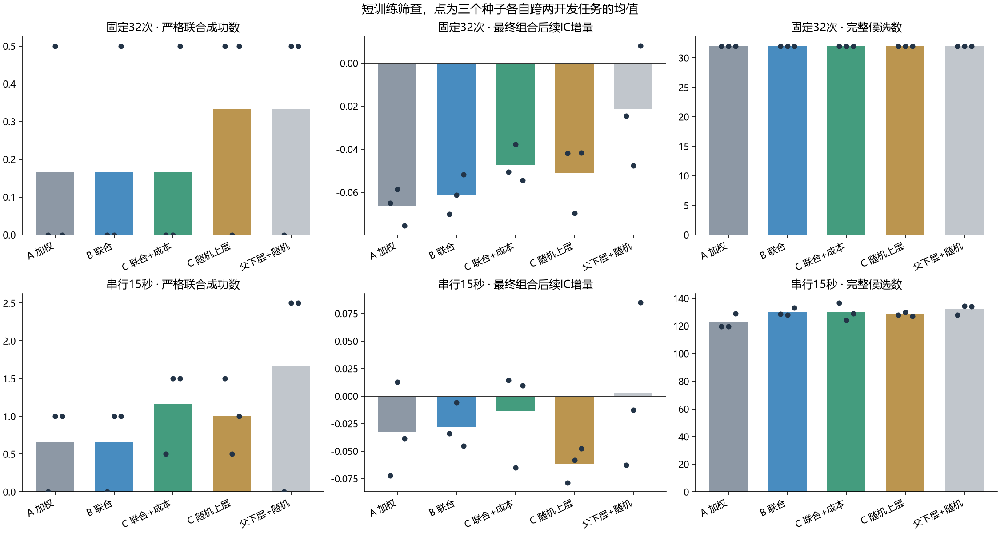

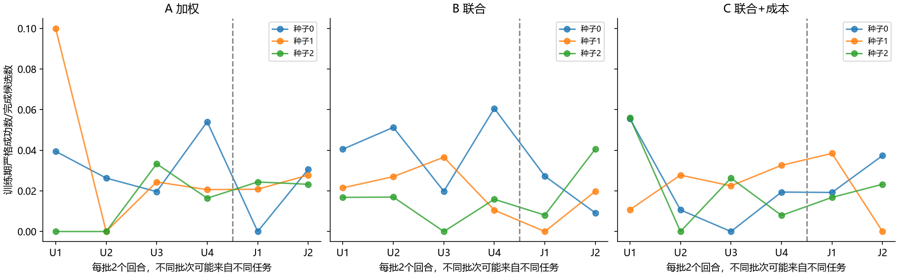

图中各批可能来自不同历史任务。六次上层更新尚未建立收敛结论，固定验证任务的逐次学习曲线仍需补充。

## 附录C　此前实验、工程修复与文献机制

### C.1 方案演化

| 阶段 | 处理内容 | 结果及作用 |
|---|---|---|
| 11月6日初版 | 上层选起点、下层AST编辑、真实评价与组合更新 | 建立完整运行入口 |
| 11月7日至9日基础复核 | 标签日历、数值合法性、缓存隔离、GAE、大起点库 | 起点库最终为399条，992项收益标签抽样独立复算最大误差为0 |
| 后续反馈与任务条件 | 共同完成反馈、持续起点与组合条件、交替更新 | 条件传入已核验，旧条件敏感性约0.02%至0.21% |
| 独立下层诊断 | 固定随机上层，比较结构初始化与金融PPO | 部分搜索产出提高，后续质量与组合价值未稳定受益 |
| 四组机制筛查 | RPN编码、上层信用分配、历史后续反馈、位置身份，共24个离线版本 | 工程修复与金融评价分别记录 |
| 原生RPN速度对照 | token编辑、训练轨迹与缓存优化 | 完整吞吐提升约7.3% |
| 本轮目标对齐 | A、B、C三组训练，D、E评价对照 | 9个模型、60次评价，整体尚未超过E |

不同阶段的时间预算、数据处理与检查点不同，数值在各自配对协议内解释。[历史诊断报告](双层PPO_架构诊断与训练验证_20261109.md) · [任务交接](任务交接_双层PPO实验_20261109.md)

### C.2 语料与位置身份修复

旧512条结构语料中93条原公式不符合当前数值规则，2048条逆标签中907条不在当前编辑核。读取入口补齐检查后，后续使用重建的144条合法结构语料。旧语料对历史初始化的影响尚未单独隔离。

原Actor对相同子表达式的不同出现位置强制同分。例如`sub(close,delay(close,1))`中的两处`close`缺少可区分的位置身份。加入零初始化的位置向量后，单公式可表达性检验通过。金融对照中，30秒严格成功均值为位置组0.83、对照1.17，其金融优势尚未建立。

### C.3 RPN速度结论的适用范围

四步训练录制预热场景的均值为优化AST 12.540毫秒、原生RPN 51.615毫秒，出现缓存慢点。两组工作集48794与45066条动作，超过原40000条预算。本轮将原生缓存预算改为80000条，该容量变化尚无单独的整套速度复验。

同权重RPN树后端与原生后端，在固定32次的12组比较中，候选流、最终组合及金融结果一致。真实500股票面板上，组合缓存与重算IC的最大误差为4.29e-15，动作概率误差为0。此前完整搜索1.2至2倍的提速预测偏高，采用实测约7.3%的结论。

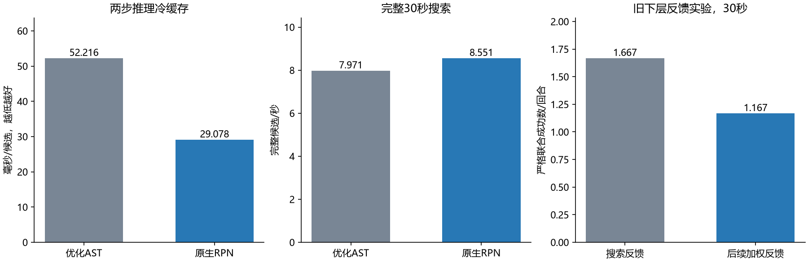

### C.4 跨领域文献提供了哪些机制启发

| 来源 | 提炼的机制 | 对本研究的具体启发 |
|---|---|---|
| 资源选择论文，arXiv 2509.25850 | 用实际下游结果评价所分配资源 | 评价起点扩展后的成果 |
| FeUdal Networks | 子任务在执行过程中持续接收目标条件 | 每步编辑继续接收起点与组合背景 |
| HIRO | 下层变化会改变上层面对的转移规律 | 下层更新后重新采集上层轨迹 |
| 用户提供的HRL-CAP摘要 | 局部任务与共同新增覆盖之间协调 | 用因子新增信息及组合贡献协调局部编辑 |

HRL-CAP目前仅核实题录，机制细节依据用户摘要，全文尚未审阅。具体奖励、程序编辑和金融验证按本任务建立。[资源选择论文](https://arxiv.org/abs/2509.25850) · [FeUdal](https://arxiv.org/abs/1703.01161) · [HIRO](https://arxiv.org/abs/1805.08296) · [HRL-CAP](https://doi.org/10.1016/j.ins.2026.123660)

## 附录D　训练可信度、失败记录与复现

### D.1 本轮审计

9个模型共54次下层更新及54次上层更新。每个种子三组的初始下层参数、零扩展后的上层函数、首批64个下层动作及续采样终点逐项一致。两次联合批均核验下层先更新、上层随后重新采集。最大旧概率重放误差为9.54e-07。新检查点格式9记录上层表示和成本上下文，旧格式按已有元数据恢复。[配对与更新审计](../var/experiments/rpn_goal_alignment_20261110/paired_initial_and_update_audit.json)

修正了独立下层入口忽略`search_training`而使用普通单因子拟合奖励的缺口，接入真实搜索任务采集。无保护联合入口的顺序由上层更新后采下层，统一为下层更新后重新采上层。

本轮相关回归128项通过、1项CUDA跳过。全仓回归603项通过、9项失败、1项跳过，另有163个子测试通过。失败包含3项ClickHouse配置、5项前置测试注册`double_test`造成的算子全局污染，以及1项CLI命名空间包入口问题。QuantOps独立复验为139项通过、1项CLI失败，算子相关断言通过。根目录单独收集QuantOps的包导入失败日志也已保留。[相关回归](../var/experiments/rpn_goal_alignment_20261110/relevant_final_regression.log) · [全仓回归](../var/experiments/rpn_goal_alignment_20261110/final_regression.log) · [独立复验](../var/experiments/rpn_goal_alignment_20261110/isolated_quantops_package_root.log)

限时评价每5秒抽样供电状态，147次抽样均为接通电源且省电模式关闭。该记录的采样粒度为5秒。[供电记录](../var/experiments/rpn_goal_alignment_20261110/power_samples.jsonl)

### D.2 历史修正与失败恢复

此前33个模型的检查点阶段统计已按同阶段首次最高验证值修正。86份旧报告另存，132个旧检查点保存哈希。第三阶段9模型、72联合批、432回合、20736次上层动作通过审计。

历史运行出现过资源争用导致尝试数不足、导入失败、旧语料不兼容，以及PowerShell将Python警告当作失败的启动问题。相关失败运行和成本已隔离保留。原生RPN首版保存在`v1_before_native_recording_optimization`，后续启动使用隐藏独立进程、分离stdout与stderr、按真实退出码判断。

本轮保存修改前源码、冻结运行源码、模型与优化器、随机状态、二进制轨迹和逐次评价。启动脚本在运行期间阻止自动休眠，结束时复位。云实例为0，费用为0元。

### D.3 查看记录

在PowerShell中运行以下命令。

```powershell
$r = 'D:\Projects\Python\QuantLab-backtest\var\experiments\rpn_goal_alignment_20261110'
Get-Content "$r\progress.json"
Import-Csv "$r\comparison.csv" | Format-Table -AutoSize
Get-ChildItem "$r\runs\*\training_seed_*\progress.json" | ForEach-Object { $_.FullName; Get-Content $_ }
Get-Content "$r\training.log" -Tail 20
```

运行源码、完整配置与`workflow.ps1`共同构成实验记录。修订前文档另存，原始实验文件及封存清单保留，文档修订单独记录来源和哈希。[修订前稿](../var/experiments/rpn_goal_alignment_20261110/report_revisions/teacher_revision_20261110/修订前_双层PPO_实验演化与RPN目标对齐验证_20261110.md)


## 附录E　五分钟按轮次讲述的提纲

1. 初版短训练与工程复测均未建立优势，扩大更新量后又暴露起点少和评价口径问题。
2. 使用402/401条真实起点并修复缓存、随机状态和GAE后，上层仍落后于简单调度，随后扩大到399起点、8滚动任务和3种子正式比较。
3. 延长训练、提高学习率、保留联合工作模型和加入任务条件，分别出现局部改善，但跨期组合价值仍不稳定。
4. 表示、上层信用、历史后续下层奖励和位置身份分别检验，随后实现原生RPN，完整吞吐提升7.3%。
5. 最新三组九模型训练后，严格成功0.67、0.67、1.17，父RPN随机上层1.67。下一步先解决91.3%零奖励和组合价值脱节，再依据固定验证曲线追加训练。

## 附录F　指标含义及组合IC方向


一个因子可以在当前数据中表现较好，却与已有因子重复，或者加入组合后没有产生新增价值。因此，本研究将目标拆成三个条件。

| 条件 | 实际检验内容 | 所回答的问题 |
|---|---|---|
| 单因子有效 | 覆盖率、IC、RankIC等达到门槛，并在后续期继续检验 | 公式是否包含可延续的预测信息 |
| 非重复 | 检查公式结构、信号等价和与已有因子的相关性 | 是否带来了已有因子之外的信息 |
| 对组合有增量 | 比较加入候选前后的组合表现 | 这条新增信息是否改善了组合 |

本轮将同时满足三项条件的发现记作一次**严格成功**。搜索效率用固定时间内的严格成功次数衡量。同时报告最终组合的表现，观察整个搜索过程是否使组合变好。

### 1. 结果表里的几个数字分别是什么

**搜索发现数**是当前搜索期通过有效性和去重检查的新增候选数。**后续达标数**是在这些候选中，后续期仍达到单因子门槛的数量。**严格成功数**进一步要求候选相对当时的组合产生正的后续IC增量。

**最终组合后续IC增量**等于搜索结束时组合的后续IC，减去搜索开始时组合的后续IC。

例如，初始组合IC为0.03，最终组合IC为0.04，增量就是＋0.01。初始为−0.04、最终为−0.02时，增量为＋0.02，含义是相对改善，组合IC本身仍为负。

严格成功考察每次发现当时的边际贡献，最终组合增量考察整轮搜索的结果。后面的候选会改变组合成员，因此这两项需要一起阅读。

### 2. 为什么组合增量保留IC的正负号

IC衡量信号与收益之间的相关关系。新旧组合各自只用拟合期数据确定方向和权重，进入后续期后按这组方向和权重评分。负相关单因子可以在拟合期决定反向使用。

如果旧组合后续IC为＋0.03，新组合后续IC为−0.08，按事先确定的使用方向，增量为−0.11。取绝对值之差会得到＋0.05，隐含了看到后续结果之后再翻转新组合方向的操作。因此，当前评价使用锁定方向后的有向IC。

以上数值用于说明指标含义。实际实验采用后续有向IC至少0.02、RankIC至少0.01、覆盖率至少0.8等门槛。严格成功还要求边际组合增量大于数值容差1e-12。完整设置见附录A。


## 附录G　第16轮五组方法和实际奖励


为检验奖励定义与上层信息是否有帮助，本轮设置A、B、C三个训练组，以及D、E两个评价对照。下层均采用原生RPN编辑。

这里把本轮修改前已经训练好的RPN下层称为父模型。A、B、C在它的基础上继续训练，E直接使用它。

| 编号与名称 | 下层怎样获得 | 上层怎样选择 | 本组用于回答什么 |
|---|---|---|---|
| A 加权奖励双层PPO | 从已训练RPN父模型继续训练 | PPO，原有观测 | 加权奖励作为本轮训练对照 |
| B 严格成功奖励双层PPO | 同一父模型，改用严格成功奖励继续训练 | PPO，原有观测 | B与A比较，检验奖励定义 |
| C B组＋耗时/贡献统计 | 与B相同的目标，进行相同阶段训练 | PPO，增加耗时与可见贡献率 | C与B比较，检验新增信息整体的作用 |
| D C组下层＋随机上层 | 直接使用C训练后的下层，参数冻结 | 随机选择 | C与D比较，检验学习后的上层调度 |
| E 原有RPN下层＋随机上层 | 使用本轮修改前已经训练好的父下层，参数冻结 | 随机选择 | 检验整个改造是否超过已有生成器 |

A、B、C从每个种子的同一父模型出发，共用配对初始化和更新预算。它们均开启下层任务条件和位置身份。D与C共用同一个最终下层。E保留父下层的原有设置，因此C与E衡量本轮整体改造的效果。

随机上层的动作空间是当时的起点短名单加NEW，并在其中均匀采样。

### 1. A与B的奖励区别

下面的奖励针对一个完成编辑的候选。记e为搜索期合格且非重复，q为该候选后续单因子达标，d为候选相对本次动作前组合的锁定后续IC增量。

A组使用加权奖励。

\[
r_A=e\,[\mathbf{1}(q)+50d]
\]

B、C组使用严格成功奖励及有界损害惩罚。

\[
r_{B,C}=e\left[\mathbf{1}(q\land d>10^{-12})
-\min\left(\max\left(\frac{-d}{0.02},0\right),1\right)\right]
\]

公式中的指示函数在条件满足时取1，否则取0。所有组最终都按同一套严格成功指标验收。

以下是假设候选已经通过搜索期有效性与去重、且后续单因子达标时的奖励示例。

| 后续组合IC增量d | A组奖励 | B、C组奖励 | 区别 |
|---|---:|---:|---|
| ＋0.01 | 1.5 | 1 | B、C给一次严格成功分 |
| 0 | 1 | 0 | A仍给单因子达标分 |
| −0.01 | 0.5 | −0.5 | A的数量分可以抵消组合损害 |

当前实现会将大量未通过前置检查的候选奖励置为0。这一设计的实际影响见第七节。

### 2. C增加的两个观测有什么含义

**平均扩展耗时**描述从一个起点完成一次选择、扰动、编辑和主候选评价所需的时间。实际输入使用它相对全局平均耗时的比例，再作对数变换。**可见贡献率**描述此前从该起点扩展时，搜索期产生正组合增量的次数占尝试次数的比例。

耗时信息希望帮助上层分配单位时间内的有效产出。例如，每次成功概率20%、耗时0.2秒的起点，预期每秒成功1次。每次成功概率30%、耗时1秒的起点，预期每秒成功0.3次。这是解释设计动机的假设例子。

本轮同时加入这两个输入，因此C与B的差异只能归因于这组观测改动整体。平均耗时单独是否有效，还需要拆分对照。[本轮预登记与配置](../var/experiments/rpn_goal_alignment_20261110/preregistration.json)


## 附录H　文档修订与实验来源

本稿按训练轮次重新组织已有实验记录。原始模型、逐次评价和上一版文档分别保留，旧轮次的源文件与最新开发评价具有不同的时期和协议。

[上一版教师主题稿](../var/experiments/rpn_goal_alignment_20261110/report_revisions/chronological_revision_20261110/修订前_教师主题版.md)

本次补图使用各轮保留的结果表和更新日志，图中均值、原始更新点与来源文件记录在图表数据中。[图表数据记录](../var/experiments/rpn_goal_alignment_20261110/report_revisions/round_visuals_20261110/chart_evidence.json)
